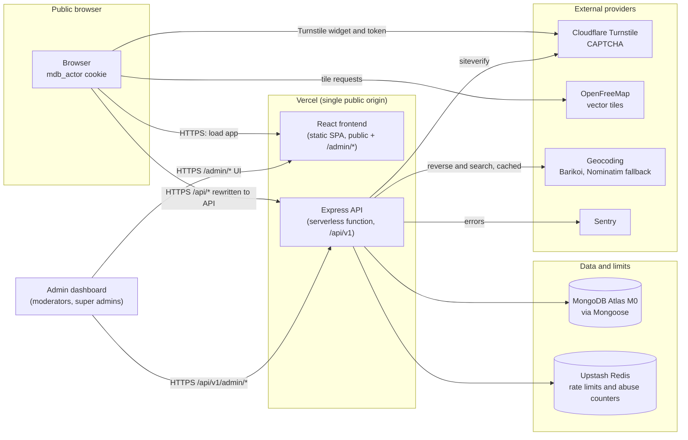
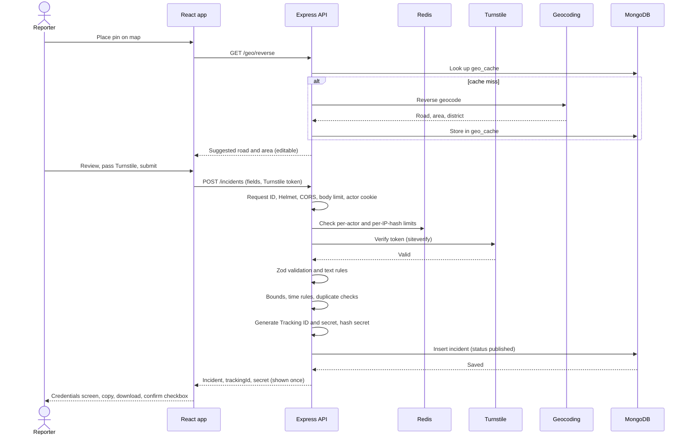
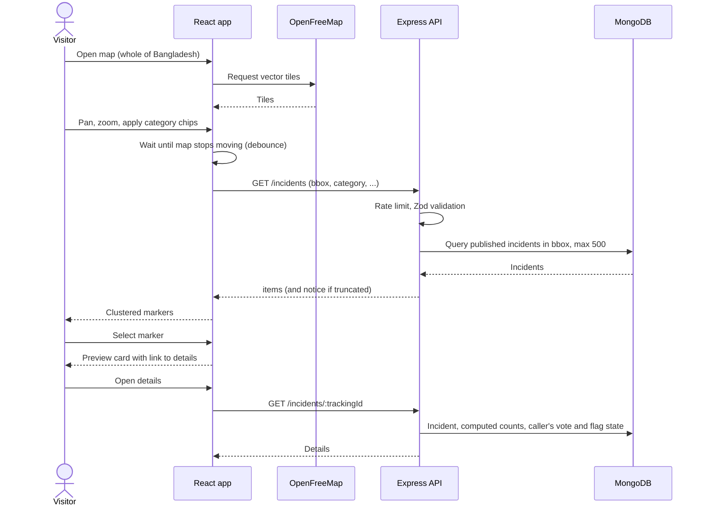
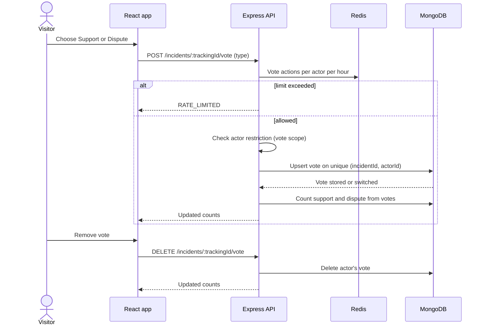
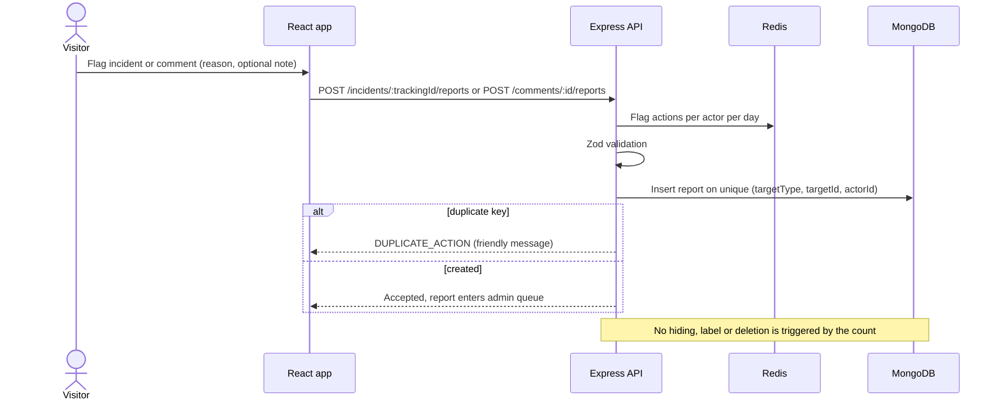
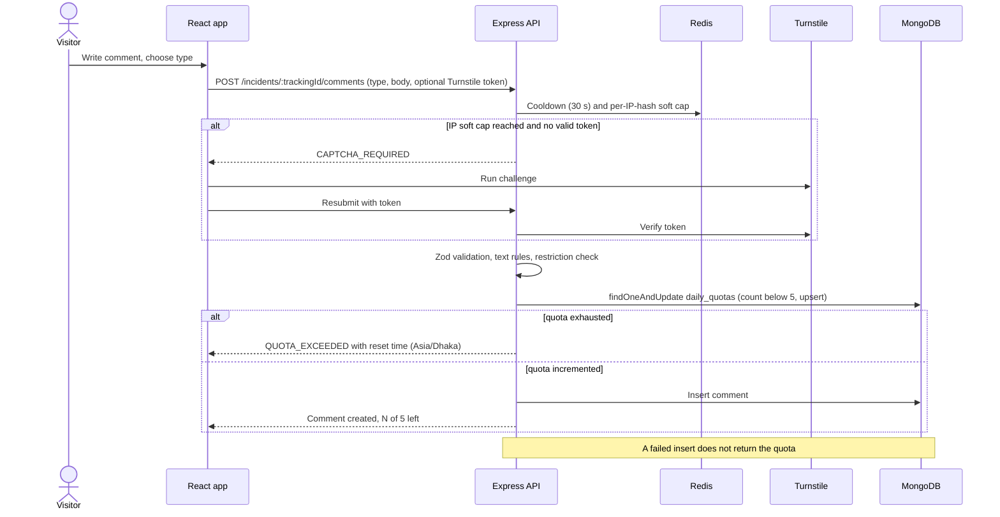
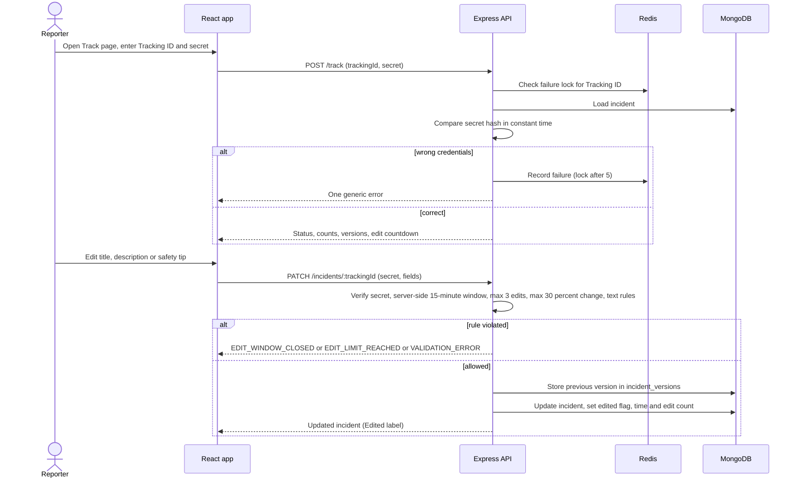
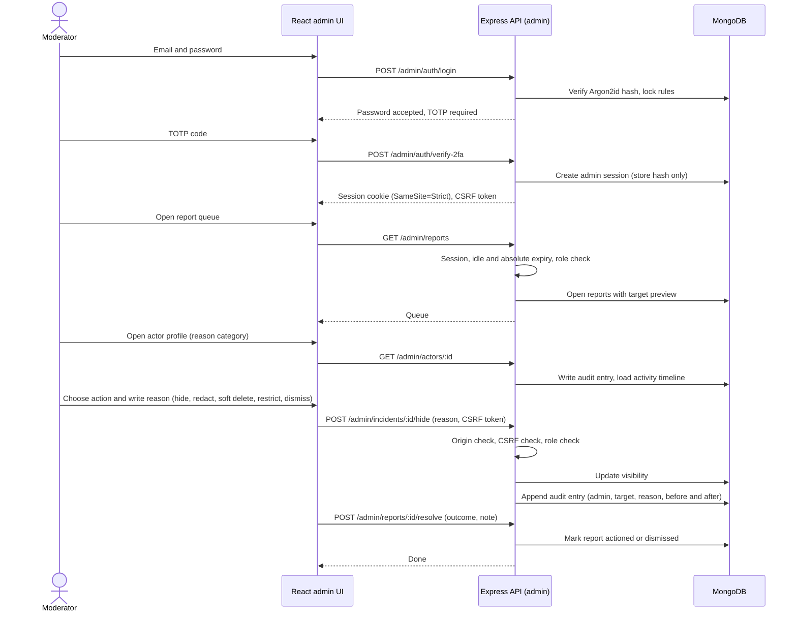

# Mamladibe — System Architecture

| | |
|---|---|
| Version | 0.1 (draft for review) |
| Date | 10 November 2026 |
| Based on | `Mamladibe_PRD_v1.0_Final.pdf` (v1.0, 9 November 2026) |
| Owner | Team Epsilon |
| Status | NEEDS REVIEW (see sections 13 and 14) |

## 0. Source documents and how to read this file

This document describes **how** Mamladibe V1 is built. The PRD describes **what** it must do.

| Source | Status at time of writing | How it is used here |
|---|---|---|
| PRD v1.0 Final | Present | Primary source for every requirement, parameter, endpoint and field referenced here. |
| `Database.md` | **Not found in the repository** | The task names it as the database source of truth. Until it exists, PRD section 9 is used as the interim schema reference. This file does **not** restate the schema; it only refers to collection names. |
| `Design.md` | **Not found in the repository** | PRD section 7 is used as the interim UI reference. |
| `.env` | **Not found** | Variable names are taken from PRD section 14.3 only. No values are read, printed or referenced. |
| Existing frontend / backend config | **Not found** (the repository currently contains only the PRD PDF) | Folder structures below follow PRD sections 7.6 and 8.1. |

Rules followed in this document:

- No endpoint, collection or field is invented. Anything not in the PRD is labelled **Proposed** or **TO BE CONFIRMED**.
- Conflicts between sources are recorded in section 13, not silently resolved.
- Numbers (limits, windows, quotas) are quoted from PRD section 5 and are not redefined here.

---

## A. System overview

Mamladibe is an anonymous, location-based incident reporting and community discussion platform. There is no public registration or login. Valid reports are published immediately. The system never decides whether a report is true or false, and report counts never hide or delete content automatically. V1 is text-only, supports comments, and is launched nationwide in Bangladesh (default map view centred on Dhaka — see conflict C-01).

| Component | Responsibility |
|---|---|
| **Public browser** | Runs the React app. Holds the `mdb_actor` cookie (HttpOnly, so not readable by scripts). Loads map tiles directly from the tile provider. Holds the reporter secret in memory only. |
| **React frontend (client)** | Public UI (map, report, incident, track, search, static pages) and the admin UI under `/admin/*`. Validates input for usability, never as the security boundary. |
| **Express API (server)** | The single trusted boundary. Enforces validation, rate limits, quotas, CAPTCHA, anonymous identity, authorization and all business rules (in services only). |
| **MongoDB Atlas (M0)** | System of record for all content, actors, quotas, admin accounts, sessions and audit logs. Enforces one-action rules through unique indexes and expires data through TTL indexes. |
| **Upstash Redis** | Shared counters for rate limits and abuse signals that must work across serverless instances. Holds no content. |
| **Cloudflare Turnstile** | CAPTCHA. The browser obtains a token, the API verifies it server-side. |
| **Map tile provider (OpenFreeMap)** | Vector tiles for MapLibre. Browser-to-provider only. Incident data does not depend on it. |
| **Geocoding provider (Barikoi, Nominatim fallback)** | Converts pin to road/area/district and place name to coordinates. Accessed only through the backend proxy. |
| **Admin dashboard** | Authenticated area of the same SPA, served from the same origin, calling `/api/v1/admin/*`. Separate role checks, session, CSRF and audit. |
| **Sentry** | Error tracking (PRD 8.1). |
| **GitHub / GitHub Actions** | Source control and CI. |

---

## B. High-level architecture



Key communication paths:

1. The browser sees **one origin**. Vercel serves the SPA and rewrites `/api/*` to the backend project, so the actor cookie is first-party (PRD 7.6, 14.3).
2. Only the API talks to MongoDB, Redis, Turnstile (verification) and the geocoding providers. Provider keys never reach the browser.
3. The browser talks directly to the tile provider and to Turnstile (widget).
4. The admin UI is part of the same SPA but uses a separate API prefix, session cookie and CSRF token.

---

## C. Frontend architecture

### C.1 Stack (PRD 7.6)

React 18, Vite, TypeScript (strict), React Router, TanStack Query, React Hook Form + Zod, MapLibre GL JS (with clustering), Tailwind CSS with design tokens, react-i18next, Vitest + Testing Library, Playwright, axe.

### C.2 Folder structure

Top level follows PRD 7.6. Sub-folders inside `features/` are **Proposed**.

```text
client/src/
  app/            routes, layout, providers (QueryClient, i18n, router)
  features/
    map/          map view, markers, clusters, preview card, filter chips, near-me
    report/       4-step form, location picker, credentials screen
    incident/     details page, support/dispute, flag dialog
    comments/     comment form, quota indicator, comment list
    track/        track form, private view, countdown, edit form, version list
    search/       search page, filters, sort, pagination
    admin/        login, dashboard, incidents, comments, reports, actors,
                  admin users, audit log, settings   (lazy-loaded chunk)
  components/     ui primitives (Button, Badge, Card, Dialog, Toast)
  lib/            api client, zod schemas, i18n setup, constants
  locales/        en.json, bn.json
```

### C.3 Pages and routes (PRD 7.2)

| Route | Page |
|---|---|
| `/` | Map home |
| `/incident/:trackingId` | Incident details |
| `/report` | New report (Category, Details, Location, Review and CAPTCHA), then credentials screen |
| `/track` | Track my report |
| `/search` | Search results |
| `/about`, `/how-it-works`, `/guidelines`, `/terms`, `/privacy`, `/contact` | Static help and legal pages |
| `/admin/login` | Admin sign-in |
| `/admin/*` | Admin area |

Map position, zoom and filters live in the URL query string so views can be shared (FR-03.4). Exact query parameter names are **TO BE CONFIRMED**.

### C.4 Feature-based modules

Each feature owns its components, hooks (TanStack Query wrappers) and local types. Features do not import from each other; they share only `components/` and `lib/`. The admin feature is lazy-loaded so public bundles do not include admin code (initial JS budget: under 250 KB compressed before the map chunk, PRD 13).

### C.5 Shared components

Button, Badge, Card, Dialog, Toast (PRD 7.6). Category markers and badges always combine colour, icon and text label (PRD 7.5). Touch targets at least 44 px.

### C.6 API client

- One typed client in `lib/` wrapping `fetch`. Base path `/api/v1`, JSON only, same origin, credentials included.
- Parses the standard error envelope `{ error: { code, message, details } }` and maps `code` to a translated, user-friendly message (never raw server text).
- Secrets (reporter secret) are sent only in request bodies, never in URLs or query strings.
- Admin requests additionally send the CSRF token (mechanism **TO BE CONFIRMED**, see U-07).

### C.7 State management

- **Server state:** TanStack Query (caching, retries, debounced map queries).
- **Form state:** React Hook Form.
- **URL state:** map viewport, filters, search parameters.
- **Ephemeral client state:** report draft and reporter secret are kept **in memory only**; the secret is cleared when leaving the Track page (PRD 7.4). No client-side global store is introduced unless a concrete need appears.
- Nothing sensitive is written to `localStorage`. Only the language preference is remembered in the browser (FR-16.1).

### C.8 Form validation

Zod schemas validate on the client for fast feedback and are the same rules enforced by the server (PRD 7.6 "shared rules with the backend"). The server remains authoritative. How the schemas are shared between `client/` and `server/` is **TO BE CONFIRMED** (U-05). Limits come from the single constants file described in PRD section 5.

### C.9 Error handling

- Route-level error boundary and a global toast for unexpected errors.
- Friendly messages for: validation errors, `RATE_LIMITED` ("Try again in N minutes"), `QUOTA_EXCEEDED` (with reset time), `CAPTCHA_REQUIRED`, offline, server error (PRD 7.4).
- Error code list is the one in PRD 8.2.
- Never render raw error text or stack traces.

### C.10 Map integration

- MapLibre GL JS with the style URL taken from configuration (so the provider can be switched without a code change, PRD 11.4).
- Lazy-loaded map chunk, code splitting per route.
- Incidents are fetched for the visible bounding box after the map stops moving (debounced), maximum 500 per request, with a "Zoom in to see more" notice when truncated (FR-03.3).
- Clustering for overlapping markers; markers coloured by category.
- Pin placement on `/report` (draggable pin). GPS (`Use my location`) only centres the map; the stored value is the pin (FR-02.1).
- OpenStreetMap attribution is always displayed (launch gate).
- If tiles fail to load, the list/search views and incident details still work (see section K).

### C.11 Admin / public UI separation

- Same SPA, same origin, separate route subtree `/admin/*` with its own layout, route guard and lazy-loaded chunk.
- Admin pages are `noindex`, not linked from public pages, and served with no-store cache headers (PRD 10.4).
- The route guard is only a UX convenience. **Every** admin API call is authorized on the server.
- Admin UI uses its own session cookie (SameSite=Strict) and never shares auth state with the public actor cookie.

---

## D. Backend architecture

### D.1 Runtime and structure (PRD 8.1)

Node.js 20, Express, TypeScript, deployed as a Vercel Function. The Express app is exported from `app.ts`; `api/index.ts` is the Vercel entry point. Business rules live in **services only**.

```text
server/src/
  routes/  controllers/  services/  models/  middleware/
  lib/       crypto.ts  geo.ts  quota.ts  captcha.ts  ratelimit.ts  text-rules.ts
  admin/     auth/ incidents/ comments/ reports/ actors/ users/ audit/ settings/
  config/    constants.ts  env.ts
  app.ts                (exported Express app)
  api/index.ts          (Vercel entry)
```

### D.2 Layer responsibilities

| Layer | Responsibility | Must not |
|---|---|---|
| Routes | Map method + path to middleware chain and controller. | Contain logic. |
| Controllers | Parse validated input, call one service, shape the HTTP response. | Touch models directly or hold business rules. |
| Services | All business rules: bounds check, duplicate detection, quota, edit rules, moderation actions, audit writes. | Know about `req`/`res`. |
| Models | Mongoose schemas and indexes, aligned with `Database.md`. | Contain business rules. |
| `lib/` | Stateless helpers: hashing, ID generation, geo helpers, text rules, CAPTCHA and rate-limit adapters. | Hold state. |
| `config/` | Named constants (all PRD section 5 values in one file) and validated environment access. | Print or log secret values. |

### D.3 Routes

Routes are exactly those in PRD 8.3 (public) and 8.4 (admin). Base path `/api/v1`, admin under `/api/v1/admin`.

| Group | Endpoints (from PRD) |
|---|---|
| System | `GET /health`, `GET /meta` |
| Incidents | `POST /incidents`, `GET /incidents`, `GET /incidents/:trackingId`, `PATCH /incidents/:trackingId` |
| Votes | `POST /incidents/:trackingId/vote`, `DELETE /incidents/:trackingId/vote` |
| Flags | `POST /incidents/:trackingId/reports`, `POST /comments/:id/reports` |
| Comments | `GET /incidents/:trackingId/comments`, `POST /incidents/:trackingId/comments`, `DELETE /comments/:id` |
| Tracking / quota | `POST /track`, `GET /me/quota` |
| Geo proxy | `GET /geo/reverse`, `GET /geo/search` |
| Admin | As listed in PRD 8.4 (auth, dashboard, incidents, comments, reports, actors, users, audit, settings) |

### D.4 Middleware order (PRD 8.1)

1. Request ID
2. Security headers (Helmet)
3. CORS allow-list
4. Body size limit (20 KB)
5. Actor cookie
6. Rate limiter
7. CAPTCHA verification (only where required)
8. Zod validation
9. Handler (controller → service)
10. Error handler

Additional per-request checks (Origin check on state-changing calls, admin session and role check, admin CSRF) sit between steps 5 and 9. Their exact position is **Proposed**: Origin check right after CORS; admin session, role and CSRF checks before validation, on `/admin` routes only.

### D.5 Validation

- Zod, strict objects: unknown fields rejected (FR-12.1).
- Only validated primitives reach Mongo queries. Raw user objects are never placed in filters (NoSQL injection control).
- Text rules (`lib/text-rules.ts`): reject links, email addresses and phone numbers in text fields (FR-01.2, FR-13.3).
- Geographic bounds and time rules (not in the future, not older than 90 days) are checked in services against the constants file.

### D.6 Error handling

- Single error handler producing `{ "error": { "code", "message", "details" } }`.
- Codes are exactly those in PRD 8.2: `VALIDATION_ERROR`, `RATE_LIMITED`, `QUOTA_EXCEEDED`, `CAPTCHA_REQUIRED`, `FORBIDDEN`, `UNAUTHORIZED`, `NOT_FOUND`, `EDIT_WINDOW_CLOSED`, `EDIT_LIMIT_REACHED`, `DUPLICATE_ACTION`, `LOCKED`, `INTERNAL`.
- Unknown errors become `INTERNAL`, are logged with the request ID and sent to Sentry. Messages to clients never contain stack traces, query text or secrets.
- HTTP status mapping per code is **Proposed** (conventional mapping: 400, 429, 403, 401, 404, 409, 423, 500) and **TO BE CONFIRMED**.

### D.7 Authentication and authorization

| Surface | Mechanism |
|---|---|
| Public | None. Capabilities come from the anonymous actor, and from Tracking ID + secret for owner actions. |
| Admin | Email + password (Argon2id, min 12 characters, common-password check), then mandatory TOTP. Session cookie HttpOnly, Secure, SameSite=Strict, random 256-bit value, only its hash stored in `admin_sessions`. 8 hours absolute, 30 minutes idle. Lock for 15 minutes after 5 failed logins. |
| RBAC | Two roles: Moderator and Super Admin (PRD 10.1). Permission checks live in a single authorization layer used by every admin route; Super-Admin-only routes are marked `S` in PRD 8.4. |
| First admin | Created once by a setup script using environment variables (`ADMIN_BOOTSTRAP_EMAIL`); later admins created by a Super Admin. No public sign-up. |

Admin authorization is checked on the server for every route, with tests for each admin route without a session and with the wrong role (PRD 15.1, AC-11).

### D.8 Anonymous session management

See section F.

### D.9 Rate limiting

- Counters live in Upstash Redis so they work across serverless instances (FR-12.2).
- Keys are per actor and per hashed IP. Values are those in PRD section 5 (incidents per actor, vote actions, flag actions, comment cooldown, comments per hashed IP soft cap, tracking attempts).
- Comment daily quota is **not** a Redis counter. It is an atomic MongoDB operation on `daily_quotas` (PRD 9.2).
- Rate-limit responses use `RATE_LIMITED`; quota responses use `QUOTA_EXCEEDED`.
- Behaviour when Redis is down: see section K and U-02.

### D.10 Logging

- Structured JSON logs (pino) with the request ID.
- Never log secrets, tokens, cookies, reporter secrets or full text bodies (PRD 8.1).
- Errors go to Sentry. Log fields and retention for logs are **TO BE CONFIRMED**.
- Admin actions are recorded in `audit_logs` (database), which is separate from application logs.

---

## E. Database integration

`Database.md` is the source of truth for the schema. It is not yet in the repository (see section 0), so PRD section 9 is the interim reference. **This section does not duplicate or alter the schema.** When `Database.md` is added, any difference from PRD section 9 must be listed in section 13.

### E.1 Mongoose models

One model per collection named in PRD 9.1: `incidents`, `incident_versions`, `comments`, `votes`, `reports`, `daily_quotas`, `actors`, `abuse_signals`, `geo_cache`, `admin_users`, `admin_sessions`, `audit_logs`, `settings`. Models define fields, enums, indexes and basic schema validation exactly as in `Database.md`. Models contain no business logic.

### E.2 Connection management

- Cached connection in a module-level/global variable, pool size 5, to protect the Atlas connection limit under serverless (PRD 8.1).
- Connection is created lazily on the first request and reused by warm instances.
- Cold-start connection time is measured during performance testing (PRD 15.1).

### E.3 Collection initialization and index management (Proposed)

- Automatic index building on every cold start is **disabled** in production. Serverless cold starts must not trigger index builds.
- A dedicated, explicit initialization step creates collections and indexes from the model definitions. It is run deliberately (locally for development, and as a controlled release step for preview/production), never on an incoming request.
- The step is idempotent, never drops data, and reports differences between declared and existing indexes instead of changing them silently.
- It is **not** run against the live database as part of producing this document. Who runs it, and when, is **TO BE CONFIRMED** (U-08).

### E.4 Validation

Three layers, in order: Zod at the API boundary, Mongoose schema validation, and database constraints (unique and TTL indexes). Security-critical rules (one vote per actor, one flag per target per actor, one quota row per actor/day) are enforced by **unique indexes**, so they hold even when two requests arrive at the same instant.

### E.5 Geospatial queries

- Incident locations are GeoJSON Points rounded to 5 decimals with a `2dsphere` index (PRD FR-02.4, 9.1).
- Map queries are bounding-box queries on published incidents, capped at 500 results; "near me" and `Nearest` sort use `near` / `radiusKm`.
- The "similar report" check (200 m, same category, last 2 hours) uses the same index.
- Exact query operators are an implementation detail to be fixed with `Database.md`.
- Cursor pagination combined with `Nearest` sort is not defined in the PRD (U-04).

### E.6 Transactions

The PRD deliberately avoids multi-document transactions: counts are computed from `votes`, `reports` and `comments`, not stored (PRD 9.2, D-06), and one-action rules rely on unique indexes. Two flows still write more than one document:

| Flow | Concern | Proposed handling |
|---|---|---|
| Incident creation | `incident_versions` has a unique `(incidentId, version)`; the PRD does not say whether version 1 is written at creation. | TO BE CONFIRMED (U-06). |
| Quick edit | Previous version is stored, then the incident is updated. A failure between the two could leave inconsistent history. | Write the version first, then update the incident with a condition on the current `editCount`, so a retry or race cannot apply twice. If this is judged insufficient, use a single Mongo transaction for this flow only. Status: Proposed. |
| Comment submission | Quota increment, then comment insert. | Defined by the PRD: quota is incremented first and **not** refunded if insert fails (prevents retry abuse). |
| Admin actions | State change plus audit entry. | Write the audit entry as part of the same service call. Whether it must be atomic with the change is TO BE CONFIRMED (U-09). |

### E.7 Safe database setup

- Separate databases (or clusters) for local, preview and production. Tests use a dedicated test database, never production.
- Connection string only from `MONGODB_URI` in platform environment variables.
- Least-privilege database users per environment (Proposed).
- Destructive operations (`permanent delete`, purges) exist only as audited admin actions or TTL expiry. No script drops collections.
- Atlas network access rules and user setup are **TO BE CONFIRMED** at provisioning time.

### E.8 Migration strategy (Proposed)

- MongoDB is schemaless, so migrations are small, versioned, idempotent scripts kept in the repository.
- Each migration is reviewed in a pull request, runs first against local and preview databases, and is run on production only through the same controlled release step as index initialization.
- Prefer additive changes (new optional fields, new indexes). Destructive changes require a backup first (weekly `mongodump`, PRD 12.5).
- Tooling (a migration library vs plain scripts) is **TO BE CONFIRMED**. The PRD does not specify one.

### E.9 Data lifecycle

TTL indexes remove `daily_quotas`, `abuse_signals`, `geo_cache` and `admin_sessions` as defined in `Database.md`. Soft-deleted content (30 days), hidden content (180 days, then review) and the 2-year audit log retention (PRD 5.1) are handled by retention rules. No scheduled purge job is defined in the PRD for soft-deleted or hidden content (U-10).

---

## F. Anonymous identity architecture

### F.1 Anonymous browser token and cookie

| Item | Value (PRD 5, 12.2) |
|---|---|
| Cookie name | `mdb_actor` |
| Content | 256 random bits (the token) |
| Flags | HttpOnly, Secure, SameSite=Lax |
| Lifetime | 180 days, refreshed on use |
| Purpose | One vote and one flag per target, quotas, abuse prevention, edit and delete rights |

The cookie is the only strictly necessary cookie; a first-visit notice explains it (FR-15.2). The point at which the cookie is first issued (any request vs first state-changing interaction) is **TO BE CONFIRMED** (U-03).

### F.2 Token hashing and actorId

`actorId = HMAC-SHA256(server secret, token)`, truncated to 128 bits, hex (PRD 9). The raw token exists only in the user's cookie. The server secret is `ACTOR_HMAC_SECRET`. Rotating this secret would change every actorId and break per-actor limits and ownership of comment deletion, so rotation procedure is **TO BE CONFIRMED** (U-11; the PRD requires secrets rotated at least every 6 months).

### F.3 Reporter secret and Tracking ID

| Item | Behaviour |
|---|---|
| Tracking ID | Public, unique, `MD-` + 8 Crockford Base32 characters (no look-alikes). Unique index, regenerate on collision. Used as the public incident URL. Alone it grants no private access (D-08). |
| Secret | 128 random bits (`crypto.randomBytes`), shown as 26 Base32 characters in groups of five, **shown once**. Only its SHA-256 hash is stored. Compared in constant time. Never placed in a URL or log. Admins cannot see it. |
| Recovery | None. Stated at creation and on the Track page. |
| Lockout | 5 failed attempts per Tracking ID lock tracking and editing for 15 minutes; generic error for wrong credentials. |

Where the failed-attempt counter is stored is not defined by the PRD (U-01).

### F.4 Ownership and edit rights

- The reporter proves ownership of an **incident** with Tracking ID + secret (Track page, quick edit).
- The author of a **comment** is the same browser actor (same `actorId`); it can delete it within 15 minutes. The secret is not involved.

### F.5 Abuse prevention

Rate limits and a soft per-IP cap (Redis), daily comment quota (database), Turnstile (always on posting, risk-based on comments), duplicate detection, unique one-action constraints, actor restrictions by moderators (scope post / comment / vote, time-limited, with reason), and automatic expiry of abuse signals (7 days). IP addresses are hashed with a key that rotates daily and are never stored raw (PRD 12.2). How the daily key is derived from `IP_HMAC_SECRET` is **TO BE CONFIRMED** (U-12).

### F.6 Limitations (must be stated in the product and Privacy Notice)

- An `actorId` identifies **a browser, not a person**. It must never be described as identifying a real person.
- A person using several browsers, devices or clearing cookies gets several actors. This is an accepted residual risk (PRD 12.1).
- Users sharing a device share an actor.
- Cookie loss means losing comment-delete rights and per-actor history, but not Tracking ID + secret ownership of incidents.
- Many mobile users share one IP; therefore the IP cap triggers CAPTCHA, not a block.
- Admins see only the short actorId (first 8 characters) and activity, never raw IP, device fingerprint, secret or browser token (PRD 10.3). Opening an actor profile writes an audit entry.

---

## G. Main request flows

All flows run through the middleware chain in D.4. Diagrams show the parts relevant to each flow.

### G.1 Incident submission



### G.2 Incident discovery through the map



### G.3 Support / Dispute



### G.4 Content reporting (flags)



### G.5 Comment submission



### G.6 Quick edit



### G.7 Admin moderation



---

## H. Security architecture

| Control | Design |
|---|---|
| **Helmet / headers** | Helmet in the middleware chain. Headers per PRD 12.3: Content-Security-Policy, Strict-Transport-Security (max-age 31536000, includeSubDomains), X-Content-Type-Options nosniff, Referrer-Policy same-origin, Permissions-Policy geolocation=(self), `Cache-Control: no-store` on admin and `/track`. See conflict C-05 for CSP gaps. |
| **CORS** | Allow-list from `ALLOWED_ORIGINS`. Because the browser uses a single origin through the rewrite, cross-origin access is not needed for the public app. |
| **Secure cookies** | Actor cookie: HttpOnly, Secure, SameSite=Lax, 180 days. Admin session cookie: HttpOnly, Secure, SameSite=Strict, random 256-bit value, hash stored. HTTPS only, HSTS enabled. |
| **CSRF** | Public: SameSite cookies plus a required matching `Origin` header on every state-changing request. Admin: Origin check plus CSRF token on every state-changing call (token mechanism TO BE CONFIRMED, U-07). Secrets are accepted only in request bodies. |
| **Zod validation** | Strict objects on every endpoint, unknown fields rejected, only primitives reach queries. |
| **Rate limiting** | Redis counters per actor and per hashed IP; strict limits on login, `/track` and edit; body size limit 20 KB; max 500 per map request; 20 per page pagination. |
| **CAPTCHA** | Turnstile always on posting; on comments when risk rises or the IP cap is reached. Verified server-side only. |
| **Admin password hashing** | Argon2id, minimum 12 characters, common-password check. |
| **TOTP 2FA** | Mandatory for every admin. Secret encrypted at rest with `TOTP_ENC_KEY`. Recovery only by Super Admin reset. |
| **RBAC** | Moderator and Super Admin per PRD 10.1. Permanent delete, admin user management, settings and full audit log are Super Admin only. |
| **Audit logging** | Append-only `audit_logs`. Every admin state change writes an entry with admin, target, reason, time and before/after summaries. Opening an actor profile is also audited. Application code has no update or delete path for audit entries. |
| **Secret management** | Secrets only as platform environment variables. `.env` never committed. Provider keys only on the server. Repository secret scanning enabled. Rotation at least every 6 months and after any suspected exposure. Names: `MONGODB_URI`, `ACTOR_HMAC_SECRET`, `IP_HMAC_SECRET`, `SESSION_SECRET`, `TOTP_ENC_KEY`, `TURNSTILE_SECRET`, `VITE_TURNSTILE_SITE_KEY`, `UPSTASH_REDIS_REST_URL`, `UPSTASH_REDIS_REST_TOKEN`, `BARIKOI_API_KEY`, `SENTRY_DSN`, `ALLOWED_ORIGINS`, `ADMIN_BOOTSTRAP_EMAIL`. |
| **Data minimization** | No names, emails, phones or public accounts. No raw IP, no device fingerprint, no analytics or ad trackers in V1. GPS used only to centre the map and never stored. Hashed IPs kept 7 days. Raw secrets, raw IPs and raw browser tokens never appear in a database dump (AC-14). |
| **XSS / injection** | All text rendered as text, no `dangerouslySetInnerHTML`, output encoding in admin views, strict CSP. |
| **Clickjacking** | `frame-ancestors 'none'`. |
| **Dependencies** | Dependabot, `npm audit` in CI, lockfiles, minimal dependencies. |
| **Verification** | OWASP ASVS level 1 checklist, ZAP baseline scan, authorization tests for every admin route (PRD 15.1). |

The security properties above are targets. Legal review of Terms, Privacy Notice and content rules before launch is a PRD launch gate and is outside this document.

---

## I. External integrations

No pricing, quota or commercial-use claims are made here. Limits and terms must be confirmed in each provider's dashboard or documentation at setup, as the PRD already requires.

| Provider | Purpose | Responsibility boundary | Failure behaviour |
|---|---|---|---|
| **MongoDB Atlas** | System of record | All persistent data. Free tier has no automated backups (PRD 12.5). | See K.1. |
| **Upstash Redis** | Shared rate-limit and abuse counters | Counters only. No content, no secrets. | See K.2 and U-02. |
| **Cloudflare Turnstile** | CAPTCHA | Widget in browser, `siteverify` call from the API. Secret key server-side only. | See K.3. |
| **OpenFreeMap** | Vector tiles | Browser fetches tiles directly. Style URL is configuration. Attribution displayed. | See K.4. |
| **Barikoi** (primary geocoding) | Road, area, upazila/thana, district from a pin; place name to coordinates | Called only from the backend proxy, key on the server, results cached in `geo_cache`. | See K.5. |
| **Nominatim** (fallback geocoding) | Fallback only | Low volume, one request per second, required identification header. | See K.5. |
| **Sentry** | Error tracking | Receives errors only. Must not receive secrets, cookies or full text bodies (scrubbing configuration TO BE CONFIRMED). | Errors are still logged locally. Application behaviour does not depend on Sentry. |
| **Vercel** | Hosting, preview deployments, edge protection | Static frontend, serverless backend, `/api/*` rewrite. | Platform outage means the service is down (no SLA from provider). |
| **GitHub / Actions** | Source control, CI | Build and test pipeline, branch protection on `main`. | Deploys pause. The running service is unaffected. |

Provider abstraction: the tile style URL and geocoding provider order are configuration, so a provider can be replaced without redesign (PRD 11.4, 17.1).

---

## J. Deployment architecture

### J.1 Environments

| Environment | Purpose | Notes |
|---|---|---|
| **Local** | Development | Own database and own secrets. Never points at the production database. |
| **Preview** | Automatic per pull request | Own non-production database and secrets (database separation Proposed). |
| **Production** | Public service | Deploys automatically from `main`. |

### J.2 Hosting

| Component | Choice (PRD 14.1) |
|---|---|
| Frontend | Vercel project `client` (static build). `/api/*` rewritten to the backend project so the browser sees one origin. |
| Backend | Vercel Function running the Express app (`api/index.ts`), Node.js 20. No keep-alive ping needed. |
| Database | MongoDB Atlas M0 free cluster (can pause after long inactivity). |
| Rate-limit store | Upstash Redis |
| Domain | Default `vercel.app` domain acceptable for V1; custom domain optional. |

Vercel Hobby is for personal, non-commercial use only (PRD 14.1). Any commercial, sponsored or revenue-generating use requires moving to a paid plan or another host. This is a launch gate item.

### J.3 Environment variables

Names are listed in section H. Values live only in platform environment settings and are never committed. `VITE_TURNSTILE_SITE_KEY` is the only value intended for the browser (a public site key). `config/env.ts` validates required variables at startup and fails fast with a message naming the missing variable, never printing values.

### J.4 CI/CD

On every pull request (PRD 14.3): lint, type check, unit and API tests, build, dependency audit. Merge requires one approving review and green checks. Production deploys from `main`. Rollback by redeploying the previous deployment. Branch protection on `main`.

Tools named for testing: Vitest, Testing Library, Supertest (Proposed for API tests, since the PRD only says "API tests"), Playwright for end-to-end, axe for accessibility. Whether Playwright runs in the per-PR pipeline or on a schedule or release is not specified (U-13).

### J.5 Health checks

`GET /health` performs no database write and is used for uptime monitoring and alerts to the team. Whether it also performs a read ping to MongoDB/Redis is **TO BE CONFIRMED** (U-14). A shallow-only check cannot detect database outages.

### J.6 Logging and monitoring

Structured JSON logs with request ID, Sentry for errors, uptime check on `/health`, and an admin dashboard of key counts (PRD 13). Alerts are also needed for the upgrade triggers in PRD 14.2 (storage above 70 percent of 512 MB, operations near the free limit, tile outages, geocoding allowance).

### J.7 Backup and recovery

- Free Atlas tier has no automated backups. A scheduled `mongodump` at least weekly to private, encrypted storage. Restore tested before launch (launch gate).
- Where the schedule runs and where the encrypted storage lives are **TO BE CONFIRMED** (U-15).
- Recovery objectives (RPO/RTO) are not defined in the PRD. With weekly exports, up to a week of data could be lost.
- Security incident procedure: contain (freeze posting through admin settings, rotate secrets), assess, fix, document, notify if user data is affected.
- The emergency freeze switches (posting, comments) in `settings` act as the first containment step.

---

## K. Failure handling

Principles: reading stays available where possible, writes that depend on a failed protection fail **closed** (safer for an anonymous public service), geocoding and map failures never block reporting, and users always see a friendly message.

| # | Failure | Behaviour | Status |
|---|---|---|---|
| K.1 | **Database unavailable** | Reads and writes fail. API returns `INTERNAL` (HTTP 503 suggested). Frontend shows a friendly "try again later" state. Nothing is cached as truth in the browser. Errors go to Sentry. `/health` reports unhealthy only if it checks the database (U-14). Free Atlas cluster may also be paused after inactivity, which causes a slow first request. | Proposed |
| K.2 | **Redis unavailable** | Rate limits and abuse counters cannot be checked. Proposed: **fail closed** for post, comment, `/track`, edit, admin login; **public reads** (map, details, search) continue because they depend only on MongoDB. Votes and flags are still protected by unique indexes, but are blocked by the per-hour limits when Redis is down (fail-closed choice). The comment daily quota is database-based and unaffected. | TO BE CONFIRMED (U-02). The PRD does not define this. |
| K.3 | **CAPTCHA verification fails** | Invalid or missing token: `CAPTCHA_REQUIRED`, the form stays filled and the widget resets. If Cloudflare `siteverify` is unreachable: posting fails closed with a friendly "verification unavailable" message. For comments the conditional CAPTCHA can also fail closed only when CAPTCHA was required. | Proposed |
| K.4 | **Map provider unavailable** | Map area shows a message. Style URL can be switched in configuration. Incident data, details pages, comments and search list view still work. Reporting is not blocked, because a pin can also be set when a location is known through search or manual area text. Pin placement without tiles is degraded and should be treated as a known limitation. | Proposed |
| K.5 | **Geocoding fails** | Try Barikoi, then Nominatim, then give up. Cached results are used first. If all fail, the reporter types road/area text manually. **Reporting is never blocked by geocoding** (PRD 11.3). The server still requires valid coordinates inside Bangladesh bounds. | Confirmed by PRD |
| K.6 | **External API times out** | Every outbound call has an explicit timeout and no unbounded retries (timeout values TO BE CONFIRMED, U-16). Serverless function time limits must also be respected. Timeout is handled like the provider's failure above. Slow calls are logged without sensitive data. | Proposed |

Additional cases:

- **Rate limit hit:** `RATE_LIMITED` with retry time. Tracking lockout returns `LOCKED`.
- **Quota exhausted:** `QUOTA_EXCEEDED` with reset time at 00:00 Asia/Dhaka.
- **Frozen posting or comments** (admin settings): writes refused with a clear message; reading continues.
- **Cold start:** cached DB connection per warm instance, cold-start latency measured and excluded from the 800 ms P95 target (PRD 13).

---

## L. Architecture decisions

Status: **Confirmed** = stated in the PRD. **Proposed** = suggested here, consistent with the PRD, needs team agreement. **TO BE CONFIRMED** = open.

| ID | Decision | Reason | Status |
|---|---|---|---|
| AD-01 | React 18 + Vite + TypeScript + Tailwind frontend | PRD D-02, 7.6. Team skills, free tooling. | Confirmed |
| AD-02 | Node 20 + Express + TypeScript + Zod backend | PRD 8.1. Business rules in services only. | Confirmed |
| AD-03 | MongoDB Atlas M0 with Mongoose | PRD D-02. Geospatial queries and unique indexes. | Confirmed |
| AD-04 | Backend as serverless function on Vercel | PRD D-03. No sleeping server; requires cached DB connection. | Confirmed |
| AD-05 | Single public origin, `/api/*` rewritten to backend | PRD 7.6. First-party cookies. | Confirmed |
| AD-06 | MapLibre GL JS + OpenFreeMap; Google Maps not used | PRD D-04. No key, no usage bill. Leaflet not selected (C-02). | Confirmed |
| AD-07 | Geocoding through backend proxy: Barikoi primary, Nominatim fallback, cached 30 days | PRD 11.3. Key stays server-side. | Confirmed (Barikoi limits TO BE CONFIRMED) |
| AD-08 | Upstash Redis for rate limits | PRD 12.1, 14.1. Works across serverless instances. | Confirmed (free limits TO BE CONFIRMED) |
| AD-09 | Cloudflare Turnstile: always on posting, risk-based on comments | PRD FR-12.3. | Confirmed |
| AD-10 | actorId = HMAC of random browser token; not a person | PRD D-05. | Confirmed |
| AD-11 | Counts computed from records, not stored counters | PRD D-06. No drift, no transactions. | Confirmed |
| AD-12 | No automatic hiding or deletion from report counts | PRD D-07, P4. | Confirmed |
| AD-13 | Tracking ID is the public incident URL | PRD D-08. | Confirmed |
| AD-14 | Admin accounts separate, mandatory TOTP, Argon2id, RBAC, audit log | PRD D-09, 10.4. | Confirmed |
| AD-15 | Nationwide launch scope | PRD D-10. See C-01. | Confirmed (conflict with brief) |
| AD-16 | Comment quota is an atomic DB operation, not Redis | PRD 9.2. | Confirmed |
| AD-17 | Admin UI is part of the same SPA under `/admin/*` | PRD 7.2, 7.6. | Confirmed |
| AD-18 | Disable automatic index building in production; explicit index initialization step | Avoid index builds on serverless cold starts. | Proposed |
| AD-19 | Quick-edit write order: version first, then conditional update | Avoid inconsistent history without a transaction. | Proposed |
| AD-20 | Fail closed on write paths when Redis or CAPTCHA verification is unavailable | Safer for anonymous public writes. | Proposed (U-02) |
| AD-21 | Supertest for API tests | Task brief names it; PRD only says "API tests". | Proposed |
| AD-22 | Migration strategy: small versioned idempotent scripts, additive changes, backup first | Fits a small team, MongoDB. | Proposed |
| AD-23 | Separate databases for local, preview and production | Safe setup. | Proposed |
| AD-24 | Shared Zod schemas between client and server | PRD 7.6 states shared rules, mechanism not defined. | TO BE CONFIRMED (U-05) |
| AD-25 | Hosting plan vs non-commercial use | Vercel Hobby non-commercial rule. | TO BE CONFIRMED before launch |
| AD-26 | Backup schedule runner and encrypted storage location | PRD requires weekly export and tested restore. | TO BE CONFIRMED (U-15) |

---

## 13. Technical conflicts and inconsistencies

| ID | Conflict | Sources | Treatment here |
|---|---|---|---|
| C-01 | **Rollout scope.** The task brief says the initial rollout focuses on Dhaka. The PRD launches **nationwide**, with Dhaka only as the default map centre. | Task brief vs PRD 1, 11.4, D-10 | PRD followed (nationwide). Needs product-owner confirmation. |
| C-02 | **Map library.** The brief proposes "MapLibre GL JS or Leaflet". The PRD selects MapLibre GL JS with OpenFreeMap. | Task brief vs PRD 7.6, 11.1 | MapLibre used. Leaflet not used. |
| C-03 | **Missing source documents.** `Database.md`, `Design.md`, `docs/` and `.env` do not exist in the repository, though the brief requires reading them. | Task brief vs repository | PRD sections 9 and 7 used as interim references. Re-check when the files exist. |
| C-04 | **Stack additions in the PRD not in the brief:** pino, Sentry, React Hook Form, TanStack Query, react-i18next, Vercel, Argon2id. Brief items not in the PRD: Supertest. | Task brief vs PRD | Not a contradiction. Recorded; Supertest marked Proposed. |
| C-05 | **CSP completeness.** The PRD CSP allows only `https://tiles.openfreemap.org` and Turnstile. It does not mention Sentry, the Noto Sans Bengali font source, MapLibre web workers (usually need `worker-src blob:`), or inline styles. A strict CSP may block these. | PRD 12.3 vs 7.5, 7.6, 14.1 | CSP must be tested with the real map and Bangla font. Not changed silently. |
| C-06 | **Pagination vs Nearest sort.** The PRD requires cursor pagination (20 per page) and a `Nearest` sort, but cursor pagination over distance ordering is not defined. | PRD 5, FR-08.3 | See U-04. |
| C-07 | **Bangla search vs text index.** The PRD requires Bangla and English free-text search and a text index with `language: none`; behaviour for Bangla tokenisation has not been verified. | FR-08.1 vs PRD 9.1 | Needs a test with real Bangla data before relying on it. |
| C-08 | **Hosting terms vs use.** PRD states the product is non-commercial and Vercel Hobby is non-commercial only; the PRD also lists "sponsored" use as an upgrade trigger. Terms must be re-checked at launch. | PRD 14.1, 14.2, 17.2 | Launch gate. Not verified here. |
| C-09 | **No automated backups vs "tested restore" and weekly cadence.** The PRD sets the weekly cadence but no owner, location or schedule runner. | PRD 12.5 | See U-15. |

---

## 14. Unresolved decisions

| ID | Question | Why it matters |
|---|---|---|
| U-01 | Where is the `/track` failed-attempt counter stored (Redis or MongoDB)? | PRD says "5 failures per Tracking ID, then 15-minute lock" but names no store. |
| U-02 | Behaviour when Redis is unavailable: fail closed or fail open, per endpoint? | Not defined in PRD. Affects abuse exposure vs availability. |
| U-03 | When exactly is the `mdb_actor` cookie first issued (first request, or first interaction)? | Affects the first-visit notice and GET requests that read vote/flag state. |
| U-04 | How do `Nearest` sort and cursor pagination work together? | Cursor pagination over distance is non-trivial. |
| U-05 | How are Zod schemas shared between client and server (workspace package, copy, generated)? | PRD requires shared rules but folder structures list schemas only under `client/lib`. |
| U-06 | Is `incident_versions` version 1 written at creation, or only when an edit happens? | Determines how version history and moderation edits are reconstructed. |
| U-07 | How is the admin CSRF token generated, delivered and verified? | PRD requires it but gives no mechanism. |
| U-08 | Who runs index initialization and migrations, and when, against preview and production? | Safe database setup. |
| U-09 | Must admin state changes and their audit entries be atomic? | Audit completeness vs the no-transaction design. |
| U-10 | Which job purges soft-deleted (30 days) and hidden (180 days, then review) content? | PRD defines retention but no mechanism; TTL indexes alone do not match the "review" step. |
| U-11 | Rotation procedure for `ACTOR_HMAC_SECRET` and `IP_HMAC_SECRET`. | Rotating `ACTOR_HMAC_SECRET` changes all actorIds. |
| U-12 | How is the per-day IP hash key derived from `IP_HMAC_SECRET`? | PRD says "derived per day", no algorithm given. |
| U-13 | Does Playwright end-to-end run on every pull request? | PRD pipeline lists lint, type check, unit and API tests, build, audit only. |
| U-14 | Does `GET /health` perform a read check against MongoDB and Redis? | Shallow checks miss outages. |
| U-15 | Where does the weekly `mongodump` run and where is encrypted storage? | Launch gate: restore must be tested. |
| U-16 | Timeout values for Turnstile, geocoding and database calls. | Needed for failure handling and serverless time limits. |
| U-17 | Visibility rules for hidden/soft-deleted incidents on `GET /incidents/:trackingId`, and whether votes, flags and comments are allowed on hidden incidents. | Not defined in PRD (only that comments hide with the incident). |
| U-18 | Two-step admin login: how the intermediate "password accepted, TOTP pending" state is held between `/auth/login` and `/auth/verify-2fa`. | Needed for secure session creation. |
| U-19 | Admin session cookie name and per-IP login limits. | PRD gives properties but not names or values. |
| U-20 | Query parameter names for shareable map/filter URLs. | Frontend and API contract. |

---

## 15. Document maintenance

- Change this file together with any PRD change request (a new PRD version is required for scope changes).
- When `Database.md` and `Design.md` are added, review sections C and E against them and update section 13.
- Keep status values in section L current. Move items from Proposed / TO BE CONFIRMED to Confirmed only after a recorded team decision.
