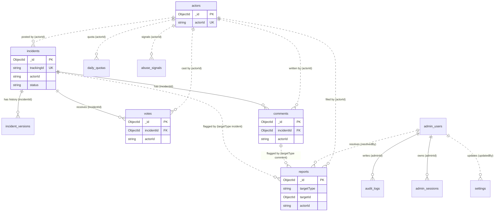
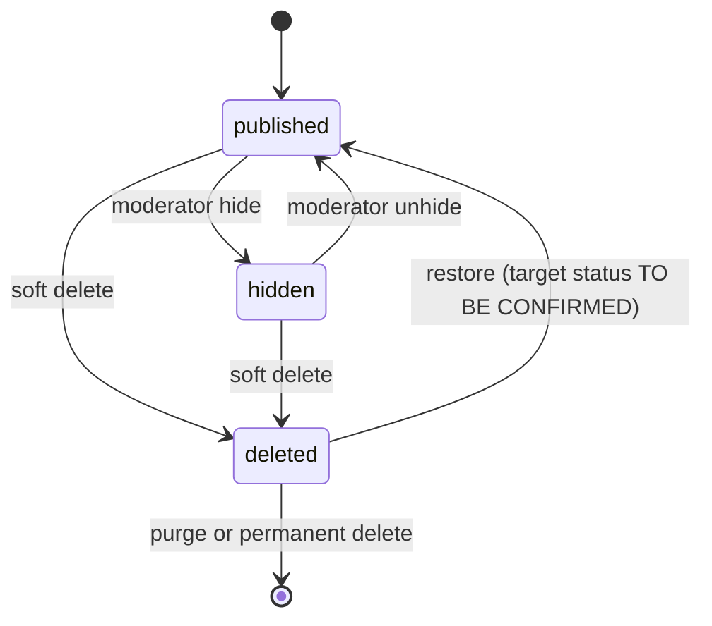

# Mamladibe — Database Specification

## 1. Document Information

| | |
|---|---|
| Version | 1.0 (draft for review) |
| Date | 10 November 2026 |
| Owner | Team Epsilon |
| Scope | MongoDB data model for Mamladibe V1 (documentation only) |
| Authority order | 1. `Mamladibe_PRD_v1.0_Final.pdf` (v1.0, 9 Nov 2026). 2. This document. 3. `docs/Architecture.md` (v0.1). Where the master task brief differs from the PRD, the PRD wins and the difference is recorded in section 16.1. |
| Status | COMPLETE WITH OPEN DECISIONS |

### 1.1 Inspection record

| Item | Finding |
|---|---|
| `docs/` contents | Only `Architecture.md`. No `Design.md`, no `api.md`. |
| Existing `Database.md` | None found. This document is a new file, not an edit. |
| Backend config, Mongoose models | None found. The repository contains only the PRD and `docs/`. |
| `.env` / `.env.example` | None found. Variable names come from PRD 14.3 and the task brief only. No values were read. |
| Live database | Not accessed. Nothing in this task connects to MongoDB. |

### 1.2 Decision labels

Every decision is labelled **CONFIRMED** (stated in the PRD), **PROPOSED** (suggested here, consistent with the PRD, needs team agreement) or **TO BE CONFIRMED** (open). Nothing proposed here becomes a requirement until it is confirmed. No schema field outside PRD section 9.1 is part of the baseline unless it is labelled PROPOSED or TO BE CONFIRMED.

---

## 2. Database Overview

Mamladibe stores anonymous, text-only incident reports with a map location, comments, Support/Dispute votes, content flags, and the data needed for human moderation. There are no public accounts.

Design principles taken from the PRD:

- **Anonymity first.** No names, emails, phones or raw IP addresses are stored for the public. Abuse control uses a pseudonymous `actorId` (an HMAC of a random browser token). An `actorId` identifies **a browser, not a person**.
- **Counts are computed, not stored** (D-06). Support, Dispute, flag and comment counts are derived from `votes`, `reports` and `comments`.
- **One-action rules are database rules.** Unique indexes make duplicate votes, flags and quota rows impossible even under concurrent requests.
- **No automatic action from counts.** No field, index or job hides or deletes content because of vote or flag totals (P4, D-07).
- **Humans decide removal.** Every moderation change is recorded in `audit_logs`.
- **Free-tier realism.** MongoDB Atlas M0 (512 MB, about 100 operations per second, no automated backups). The model avoids multi-document transactions and unnecessary collections.

Scope note: the PRD launches **nationwide in Bangladesh** (default map view centred on Dhaka). The task brief says "initially focused on Dhaka". The PRD is followed (conflict C-04).

---

## 3. Technology and Conventions

| Topic | Convention | Status |
|---|---|---|
| Database | MongoDB Atlas, free M0 cluster | CONFIRMED |
| ODM | Mongoose, cached connection, pool of 5 | CONFIRMED |
| Language | TypeScript strict mode, Node.js 20 | CONFIRMED |
| Collection names | `snake_case`, plural, exactly as PRD 9.1 | CONFIRMED |
| Field names | `camelCase` | PROPOSED (PRD uses camelCase in 9.1) |
| Internal references | MongoDB `ObjectId` (`_id`) | CONFIRMED (PRD 8.1) |
| Public identifier | Incident `trackingId` only | CONFIRMED |
| Anonymous identifier | `actorId`: 32-character lowercase hex string (128 bits) | CONFIRMED (PRD 9, 12.2) |
| Hash fields | Lowercase hex strings. SHA-256 values are 64 characters | PROPOSED encoding |
| Timestamps | BSON `Date`, always UTC | CONFIRMED (PRD 8.1) |
| Quota day | String `YYYY-MM-DD` computed in Asia/Dhaka | CONFIRMED |
| Text normalisation | Trim, and Unicode NFC normalisation before validation, hashing and storage (matters for Bangla text) | PROPOSED |
| Enum values | Lowercase strings, listed per field. Shared with Zod through one constants file | PROPOSED (values from PRD where it names them) |
| Optional fields | Omitted from the document when empty (not stored as empty string) unless a default is stated | PROPOSED |
| Default indexes | Every collection also has the automatic `_id` index. These are not counted in section 7 | CONFIRMED (MongoDB behaviour) |
| MongoDB server version, Mongoose major version | Not specified in the PRD | TO BE CONFIRMED |

Legend for field tables: **Req** = required (Y), optional (N), or conditional (C, condition in Notes).

---

## 4. Collection Inventory

PRD section 9.1 defines 13 collections. These are the baseline. The brief proposed a different list; the mapping is below.

| # | Collection | Purpose | Brief name | Status |
|---|---|---|---|---|
| 1 | `incidents` | Published reports with location | incidents | CONFIRMED |
| 2 | `incident_versions` | Previous content snapshots from edits | incident_versions | CONFIRMED |
| 3 | `comments` | Flat comment list per incident | comments | CONFIRMED |
| 4 | `votes` | One Support/Dispute vote per actor per incident | votes | CONFIRMED |
| 5 | `reports` | Flags on incidents and comments | `content_reports` | CONFIRMED (name from PRD) |
| 6 | `daily_quotas` | Atomic per-actor daily comment quota | (not in brief) | CONFIRMED |
| 7 | `actors` | Pseudonymous browser actors, restrictions, notes | `anonymous_sessions` and `blocks` | CONFIRMED (see 5.7) |
| 8 | `abuse_signals` | Short-lived hashed-IP abuse signals | (not in brief) | CONFIRMED |
| 9 | `geo_cache` | Cached geocoding results | (not in brief) | CONFIRMED |
| 10 | `admin_users` | Moderator and Super Admin accounts | admin_users | CONFIRMED |
| 11 | `admin_sessions` | Server-side admin sessions (hash only) | (not in brief) | CONFIRMED |
| 12 | `audit_logs` | Append-only admin action log | audit_logs | CONFIRMED |
| 13 | `settings` | Emergency freeze switches | (not in brief) | CONFIRMED |

Brief collections **not** created as separate collections:

| Brief name | Decision | Reason | Status |
|---|---|---|---|
| `anonymous_sessions` | Not created. Replaced by `actors`. | The PRD stores no token or token hash. The browser token exists only in the cookie; `actorId` is derived from it. There is no session to expire server-side. The cookie lifetime (180 days) is the only expiry. | CONFIRMED (PRD 9, D-05) |
| `blocks` | Not created. Restrictions are the embedded `actors.restriction` object. | PRD 9.1 and 10.2 define restrictions on the actor (scope, until, reason, setBy). A second collection would duplicate it. Network-hash blocking is not in the PRD. | CONFIRMED for embedded model. Network-hash blocks TO BE CONFIRMED (OD-12) |
| `rate_events` | Not created. | Rate limits live in Upstash Redis (FR-12.2). A database copy would duplicate Redis with no stated purpose. The single database-side limiter is `daily_quotas` (atomic comment quota, PRD 9.2). `abuse_signals` already covers short-lived hashed-IP signals. | CONFIRMED (PRD 12.1, 9.2). Recommend exclusion. |

`docs/Architecture.md` already uses the PRD names, so no rename is needed there.

---

## 5. Detailed Collection Schemas

Conventions for all examples: dates are shown as ISO strings and ObjectIds as hex strings for readability (stored as BSON `Date` and `ObjectId`). Hash and secret values are placeholders such as `<sha256-hex-64>` and are never real. No example contains a real secret, credential or personal data.

### 5.1 `incidents`

**Purpose.** One document per published (or moderated) incident. Holds the public content, location, ownership proof (secret hash) and moderation state.

| Field | Type | Req | Default | Validation | Status |
|---|---|---|---|---|---|
| `_id` | ObjectId | auto | auto | | CONFIRMED |
| `trackingId` | String | Y | generated | Pattern `^MD-[0-9A-HJKMNP-TV-Z]{8}$` (Crockford Base32, no I, L, O, U). Unique. Regenerate on collision | CONFIRMED format. Regex notation PROPOSED |
| `secretHash` | String | C | none | SHA-256 hex, 64 chars. Required when `source` is `public`. Excluded from default queries. Never returned by any API | CONFIRMED hash. Conditional rule PROPOSED (team posts have no reporter secret) |
| `title` | String | Y | | Trimmed, 5 to 100 characters | CONFIRMED |
| `description` | String | Y | | Trimmed, 20 to 2,000 characters | CONFIRMED |
| `category` | String (enum) | Y | | One of the six category slugs below | CONFIRMED (six categories). Slug values PROPOSED |
| `incidentAt` | Date | Y | | Not in the future and not older than 90 days, checked against current time at creation (service rule, not a static validator) | CONFIRMED |
| `location` | Object (GeoJSON Point) | Y | | `type` = `"Point"`. `coordinates` = `[longitude, latitude]`, exactly 2 numbers, rounded to 5 decimals, inside Bangladesh bounds (section 8) | CONFIRMED |
| `roadName` | String | N | omitted | Trimmed, max 120 | CONFIRMED (limit from FR-02.2, section 5) |
| `areaName` | String | N | omitted | Trimmed, max 120 | CONFIRMED limit. Optionality TO BE CONFIRMED (OD-09) |
| `upazila` | String | N | omitted | Trimmed, max 120 | Field CONFIRMED. Length limit PROPOSED |
| `district` | String | N | omitted | Trimmed, max 120 | Field CONFIRMED. Optionality TO BE CONFIRMED (C-10, OD-09) |
| `safetyTip` | String | N | omitted | Trimmed, 0 to 500 characters | CONFIRMED |
| `status` | String (enum) | Y | `published` | `published`, `hidden`, `deleted` | CONFIRMED |
| `isEdited` | Boolean | Y | `false` | Set true by a reporter quick edit | CONFIRMED field. Exact semantics PROPOSED (5.1.2) |
| `editedAt` | Date | N | omitted | Time of the latest edit | CONFIRMED field. Semantics PROPOSED (5.1.2) |
| `editCount` | Number (int) | Y | `0` | Integer 0 to 3. Counts reporter quick edits only | CONFIRMED (max 3) |
| `moderatedEdit` | Boolean | Y | `false` | True after a moderator redaction or moderation edit | CONFIRMED field |
| `source` | String (enum) | Y | `public` | `public` or `team` | CONFIRMED |
| `actorId` | String | C | none | 32 lowercase hex chars. Required when `source` is `public`. Absent for team posts | CONFIRMED field. Conditional rule PROPOSED |
| `contentHash` | String | C | none | 64 hex chars. Used for duplicate detection (FR-01.7). Required when `source` is `public` | CONFIRMED field. Computation PROPOSED (5.1.3) |
| `createdAt` | Date | Y | now | Server time, UTC | CONFIRMED |
| `updatedAt` | Date | Y | now | Maintained by Mongoose `timestamps` | PROPOSED (the brief asks for an update timestamp; not in PRD 9.1) |
| `hiddenAt` | Date | N | omitted | Set when status becomes `hidden`, cleared on unhide | CONFIRMED field. Clear-on-unhide PROPOSED |
| `deletedAt` | Date | N | omitted | Set when status becomes `deleted`, cleared on restore | CONFIRMED field. Clear-on-restore PROPOSED |

Category slugs (PROPOSED values; the six categories are CONFIRMED):

| Category (PRD name) | Stored value |
|---|---|
| Road Accident | `road_accident` |
| Traffic Violation | `traffic_violation` |
| Police Misconduct / Harassment | `police_misconduct` |
| Road & Infrastructure Issues | `road_infrastructure` |
| Public Safety Concern | `public_safety` |
| Other | `other` |

The brief's name for the fourth category ("Road & Infrastructure Issues") matches the PRD. Slugs must be agreed with the API contract before implementation (OD-01).

#### 5.1.1 Stored versus calculated

| Value | Stored or calculated | Status |
|---|---|---|
| Support count, Dispute count | **Calculated** from `votes` (`countDocuments` or aggregation grouped by `type`) | CONFIRMED |
| Flag (report) count | **Calculated** from `reports` where `targetType` is `incident` | CONFIRMED |
| Comment count | **Calculated** from `comments`. Counts only comments visible to the public (see 5.3) | CONFIRMED that it is computed. Visibility rule PROPOSED |
| Edit deadline | **Calculated**: `createdAt` + 15 minutes (constant `QUICK_EDIT_WINDOW`). No stored field. Checked on the server | CONFIRMED (PRD FR-09.1, section 5) |
| Edit time remaining, `isEditable` | **Calculated** at request time | CONFIRMED |
| Moderation metadata (who, why, when) | **Not stored on the incident.** Reason, admin and time are in `audit_logs`. `hiddenAt`, `deletedAt`, `moderatedEdit` mark state | CONFIRMED (every state change writes an audit entry) |
| Moderation outcome category shown on the Track page | **No stored field exists in the PRD** (conflict C-12) | TO BE CONFIRMED (OD-02) |

Candidate field for OD-02 (not part of the baseline): `moderationOutcome` (String enum, optional) holding the public outcome category, for example the PRD's "content rule" wording. Allowed values are not defined in the PRD.

#### 5.1.2 Edit-field semantics (PROPOSED, flagged for confirmation in OD-06)

- `isEdited` and `editedAt` are set by a **reporter** quick edit. `editedAt` holds the time of the latest reporter edit.
- A **moderator** edit or redaction sets `moderatedEdit = true`. The public label "Edited by moderators" is driven by `moderatedEdit` (FR-04.3). Whether a moderator edit also updates `editedAt` is TO BE CONFIRMED.
- `editCount` never exceeds 3 and counts only reporter edits.

#### 5.1.3 `contentHash` (PROPOSED)

SHA-256 (hex) of the NFC-normalised, trimmed concatenation of `title`, `description` and `safetyTip` with a fixed separator. It is not secret and contains no identity. Duplicate detection (FR-01.7) looks for the same `actorId` and `contentHash` in the last 24 hours. Exact input composition is TO BE CONFIRMED (OD-10).

#### 5.1.4 Rules, relationships, retention

- **Relationships.** One incident has many `incident_versions`, `votes`, `comments`; one incident has many `reports` (via `targetType` = `incident`). `actorId` links logically to `actors.actorId` (hash link, not a reference).
- **Unique constraints.** `trackingId`.
- **Conditional validation (PROPOSED).** If `source` is `public`: `secretHash`, `actorId`, `contentHash` required. If `source` is `team`: those three are absent. The admin who created a team post is recorded in `audit_logs`.
- **Indexes.** See section 7.
- **TTL.** None.
- **Sensitive data.** `secretHash`, `actorId`, `contentHash` are never returned by public endpoints. Public location is precise to about 1 metre (section 8.7).
- **Deletion and retention.** Kept until removed by moderation or legal request. `deleted` is a soft delete with 30-day recovery, then permanent purge unless a legal hold applies. Hidden content is kept 180 days, then reviewed for purge (PRD 5.1). Permanent delete is Super Admin only. See sections 6.4, 6.6 and 11.

#### 5.1.5 Example

```json
{
  "_id": "6731a0c2f1d2a3b4c5d6e7f8",
  "trackingId": "MD-7K3Q9XTB",
  "secretHash": "<sha256-hex-64>",
  "title": "Traffic signal not working at junction",
  "description": "The signal has been dark since this morning and vehicles are blocking the crossing.",
  "category": "road_infrastructure",
  "incidentAt": "2026-11-10T03:30:00.000Z",
  "location": { "type": "Point", "coordinates": [90.4125, 23.8103] },
  "roadName": "Airport Road",
  "areaName": "Uttara",
  "upazila": "Uttara",
  "district": "Dhaka",
  "safetyTip": "Use the service road until the signal is repaired.",
  "status": "published",
  "isEdited": false,
  "editCount": 0,
  "moderatedEdit": false,
  "source": "public",
  "actorId": "<actorid-hex-32>",
  "contentHash": "<sha256-hex-64>",
  "createdAt": "2026-11-10T04:02:11.000Z",
  "updatedAt": "2026-11-10T04:02:11.000Z"
}
```

### 5.2 `incident_versions`

**Purpose.** Preserves previous content of an incident when it is edited (quick edit or moderation edit), so history is never lost (FR-09.4). Visible to the reporter on the Track page and to admins.

| Field | Type | Req | Default | Validation | Status |
|---|---|---|---|---|---|
| `_id` | ObjectId | auto | auto | | CONFIRMED |
| `incidentId` | ObjectId (ref `incidents`) | Y | | Must reference an existing incident | CONFIRMED |
| `version` | Number (int) | Y | | Integer ≥ 1. Unique with `incidentId` | CONFIRMED |
| `title` | String | Y | | Snapshot of the previous title, same limits as `incidents.title` | CONFIRMED |
| `description` | String | Y | | Snapshot of the previous description | CONFIRMED |
| `safetyTip` | String | N | omitted | Snapshot of the previous safety tip | CONFIRMED |
| `editedAt` | Date | Y | now | Time of the edit that replaced this snapshot | CONFIRMED field. Meaning PROPOSED |
| `editedBy` | String (enum) | Y | | `reporter` or `moderator` | CONFIRMED |
| `reason` | String | C | omitted | Required when `editedBy` is `moderator`. Max length 500 | CONFIRMED field. Required-when and limit PROPOSED |

**Version numbering (PROPOSED, OD-06).**

- A snapshot of the content **before** an edit is written each time an edit is applied. The first snapshot for an incident has `version = 1` and contains the original content.
- The next number is `highest existing version for that incidentId + 1`. The unique index `(incidentId, version)` guarantees no duplicates. On a duplicate-key error (two concurrent edits) the service re-reads and retries once.
- The current content is always the live `incidents` document, so the full history is: snapshots ordered by `version`, then the live document.
- Creation does **not** write a version. This resolves Architecture.md U-06 only if confirmed.
- Quick-edit limits (FR-09.3) compare against the **original** content: the `version = 1` snapshot if it exists, otherwise the current content.

**Relationships.** Many versions belong to one incident (`incidentId`). **Unique.** `(incidentId, version)`. **TTL.** None. **Sensitive data.** Contains previously public text only. For moderator redactions it holds the original text that broke a rule, so it is admin-only content: expose to the reporter only the fields the Track page defines (FR-07.3 shows "version history", so confirm what a reporter may see of moderator-redacted originals — OD-11). **Deletion and retention.** Deleted together with the incident on permanent delete or purge (section 6.4). Not editable or deletable by itself.

```json
{
  "_id": "6731a1d4f1d2a3b4c5d6e801",
  "incidentId": "6731a0c2f1d2a3b4c5d6e7f8",
  "version": 1,
  "title": "Traffic signal not working at junction",
  "description": "The signal has been dark since this morning and vehicles are blocking the crossing.",
  "safetyTip": "Use the service road until the signal is repaired.",
  "editedAt": "2026-11-10T04:09:40.000Z",
  "editedBy": "reporter"
}
```

### 5.3 `comments`

**Purpose.** Flat, newest-first list of community comments on an incident ("Add Information"). No replies. No editing.

| Field | Type | Req | Default | Validation | Status |
|---|---|---|---|---|---|
| `_id` | ObjectId | auto | auto | | CONFIRMED |
| `incidentId` | ObjectId (ref `incidents`) | Y | | Must reference an incident that is `published` at creation time | CONFIRMED field. Published-only rule PROPOSED |
| `actorId` | String | Y | | 32 lowercase hex chars | CONFIRMED |
| `type` | String (enum) | Y | | `info` (Additional information), `correction` (Correction / different information), `experience` (Personal experience / opinion) | CONFIRMED |
| `body` | String | Y | | Plain text, 5 to 500 characters, at most 5 line breaks. No links, email addresses or phone numbers (service rule). Always rendered as text | CONFIRMED |
| `status` | String (enum) | Y | `published` | `published`, `hidden`, `deleted` | CONFIRMED |
| `createdAt` | Date | Y | now | UTC | CONFIRMED |
| `hiddenAt` | Date | N | omitted | Set on moderator hide | CONFIRMED |
| `deletedAt` | Date | N | omitted | Set on soft delete (author within 15 minutes, or moderator) | CONFIRMED field |
| `redacted` | Boolean | Y | `false` | True after a moderator redaction | CONFIRMED |

- **No `updatedAt`.** Comments cannot be edited (FR-13.8), so no update timestamp is defined. This differs from the brief's optional "update timestamp if editing is supported" (conflict C-07).
- **Daily limit.** Maximum 5 comments per actor per calendar day (Asia/Dhaka). Enforced by the backend with the atomic `daily_quotas` operation (section 5.6), not by any index on `comments`. Deleted comments still count (FR-13.4). The 30-second cooldown and the per-hashed-IP soft cap are Redis rules.
- **Visibility when the incident is hidden (PROPOSED, OD-13).** "Comments are hidden with the incident" (FR-13.10) is implemented **at read time**: a comment is public only if both the comment and its parent incident are `published`. No cascade write is performed. Reason: cascading `status = hidden` onto comments would make it impossible to tell later which comments a moderator hid individually, so unhiding the incident would reveal them.
- **Comment count** shown publicly counts comments that are publicly visible by the rule above. Whether hidden or deleted comments count towards the displayed number is TO BE CONFIRMED (OD-13).
- **Redaction.** Redact replaces text and keeps the original "for audit" (PRD glossary). No collection or field in the PRD holds the original comment text, other than the audit `before` summary. See OD-03.
- **Relationships.** Many comments belong to one incident. A comment can have many `reports` (via `targetType` = `comment`). `actorId` is a logical link to `actors`.
- **Unique constraints.** None.
- **Indexes.** See section 7.
- **TTL.** None.
- **Sensitive data.** `actorId` is never returned to the public. Flag counts on comments are visible to moderators only (FR-13.7).
- **Deletion and retention.** Soft-deleted content is kept 30 days, then purged unless on legal hold. Hidden comments are kept 180 days, then reviewed. Permanent delete is Super Admin only. Deleted comments keep counting towards the quota.

```json
{
  "_id": "6731a2e0f1d2a3b4c5d6e8a2",
  "incidentId": "6731a0c2f1d2a3b4c5d6e7f8",
  "actorId": "<actorid-hex-32>",
  "type": "info",
  "body": "The signal was repaired around 5 pm.",
  "status": "published",
  "createdAt": "2026-11-10T11:12:00.000Z",
  "redacted": false
}
```

### 5.4 `votes`

**Purpose.** One active Support or Dispute vote per actor per incident. The vote is community opinion only and never a verification.

| Field | Type | Req | Default | Validation | Status |
|---|---|---|---|---|---|
| `_id` | ObjectId | auto | auto | | CONFIRMED |
| `incidentId` | ObjectId (ref `incidents`) | Y | | | CONFIRMED |
| `actorId` | String | Y | | 32 lowercase hex chars | CONFIRMED |
| `type` | String (enum) | Y | | `support` or `dispute` | CONFIRMED |
| `createdAt` | Date | Y | now | First time this actor voted on this incident | CONFIRMED |
| `updatedAt` | Date | Y | now | Updated when the vote is switched | CONFIRMED |

- **Uniqueness (CONFIRMED).** Unique `(incidentId, actorId)`. This matches the brief: one anonymous browser identifier has one active vote per incident.
- **Switching.** Updates `type` and `updatedAt` on the same document (one count down, the other up, total unchanged). Implement as one upsert/update, not delete then insert.
- **Removing.** Hard-deletes the actor's own vote document (FR-06.3). Admins cannot delete votes (PRD 10.2).
- **Counts.** Always computed from this collection. No stored counters.
- **Relationships.** Many votes belong to one incident. `actorId` is a logical link to `actors`.
- **TTL.** None.
- **Sensitive data.** `actorId` is never public. Admins see only aggregate counts per incident and an actor's vote counts.
- **Deletion and retention.** Kept until removed by moderation, legal request or incident purge.
- Whether votes are accepted on `hidden` incidents is TO BE CONFIRMED (OD-13).

```json
{
  "_id": "6731a3f1f1d2a3b4c5d6e9b3",
  "incidentId": "6731a0c2f1d2a3b4c5d6e7f8",
  "actorId": "<actorid-hex-32>",
  "type": "support",
  "createdAt": "2026-11-10T04:30:00.000Z",
  "updatedAt": "2026-11-10T04:30:00.000Z"
}
```

### 5.5 `reports`

**Purpose.** Community flags on an incident or a comment (the brief calls this `content_reports`). Every flag enters the admin queue. A flag count never hides or deletes anything.

| Field | Type | Req | Default | Validation | Status |
|---|---|---|---|---|---|
| `_id` | ObjectId | auto | auto | | CONFIRMED |
| `targetType` | String (enum) | Y | | `incident` or `comment` | CONFIRMED |
| `targetId` | ObjectId | Y | | `_id` of the target in `incidents` or `comments` (chosen by `targetType`). Public endpoints receive `trackingId` for incidents and map it to `_id` in the service | CONFIRMED field. ObjectId type PROPOSED |
| `actorId` | String | Y | | 32 lowercase hex chars (the reporter's pseudonymous ID) | CONFIRMED |
| `reason` | String (enum) | Y | | `spam`, `fake`, `misleading`, `inappropriate`, `irrelevant` | CONFIRMED |
| `note` | String | N | omitted | Trimmed, max 200 characters. Allowed for incident flags (FR-05.1). Comment flags carry reason only (PRD 8.3 body `{reason}`) | CONFIRMED |
| `status` | String (enum) | Y | `open` | `open`, `actioned`, `dismissed` | CONFIRMED |
| `resolvedBy` | ObjectId (ref `admin_users`) | N | omitted | Set when resolved | CONFIRMED |
| `resolvedAt` | Date | N | omitted | Set when resolved | CONFIRMED |
| `createdAt` | Date | Y | now | UTC | CONFIRMED |

- **Duplicate prevention (CONFIRMED).** Unique `(targetType, targetId, actorId)`. A repeat attempt raises a duplicate-key error mapped to `DUPLICATE_ACTION` with a friendly message.
- **Flag action limit.** 20 flag actions per actor per day is a Redis rate limit.
- **Resolution.** `POST /admin/reports/:id/resolve` carries `{outcome, note}`. `outcome` maps to `status` (`actioned` or `dismissed`). The PRD has no `resolutionNote` field; the resolve note and reason are recorded in `audit_logs.reason`. A dedicated field is TO BE CONFIRMED (OD-04).
- **No automatic action.** No code path or index may use report counts to change `incidents.status` or `comments.status`.
- **Relationships.** Many reports to one incident or one comment (polymorphic by `targetType`). `resolvedBy` references an admin. `actorId` is a logical link to `actors`.
- **TTL.** None. Reports are not deletable by admins (kept for audit).
- **Sensitive data.** `actorId` is admin-only. Comment flag counts are moderator-only.
- **Deletion and retention.** Kept until removed by moderation or legal request. Handling when the target is permanently deleted: see section 6.4 and OD-05.

```json
{
  "_id": "6731a4a2f1d2a3b4c5d6eac4",
  "targetType": "incident",
  "targetId": "6731a0c2f1d2a3b4c5d6e7f8",
  "actorId": "<actorid-hex-32>",
  "reason": "misleading",
  "note": "Location looks wrong.",
  "status": "open",
  "createdAt": "2026-11-10T05:00:00.000Z"
}
```

### 5.6 `daily_quotas`

**Purpose.** The atomic per-actor daily comment quota (5 per calendar day, Asia/Dhaka). This is the only database-side limiter. All other rate limits are in Redis.

| Field | Type | Req | Default | Validation | Status |
|---|---|---|---|---|---|
| `_id` | ObjectId | auto | auto | | CONFIRMED |
| `actorId` | String | Y | | 32 lowercase hex chars | CONFIRMED |
| `day` | String | Y | | `YYYY-MM-DD` computed in Asia/Dhaka | CONFIRMED |
| `kind` | String (enum) | Y | | `comment` (only value in V1) | CONFIRMED |
| `count` | Number (int) | Y | `0` | Integer 0 to 5 | CONFIRMED |
| `expiresAt` | Date | Y | | TTL field. Set when the row is first created | CONFIRMED field. Value PROPOSED (below) |

**How the limit is enforced (CONFIRMED by PRD 9.2).** One `findOneAndUpdate` with `upsert` on `{actorId, day, kind, count < 5}` that increments `count`. If the actor already has 5, the filter matches nothing, the upsert tries to insert a second row for the same `(actorId, day, kind)`, and the unique index rejects it with a duplicate-key error, which the backend maps to `QUOTA_EXCEEDED`. The comment is inserted only after the increment succeeds, and a failed insert does not give the quota back. The unique index is the race guard; the correctness comes from the conditional atomic update.

**Rolling versus calendar day.** The brief mentions a rolling 24-hour limit. The PRD defines a **calendar day in Asia/Dhaka** with reset at 00:00 (FR-13.4). The PRD is followed (C-06). A rolling 24-hour limit cannot be enforced by an index alone; the 5-incidents-per-24-hours (rolling) limit is therefore a Redis rule, as the PRD specifies.

**`expiresAt` value (PROPOSED, OD-07).** Row creation time + 3 days (PRD: "TTL on expiresAt (3 days)"). This always lies after the end of the quota day, so a row never disappears during its own day.

- **Relationships.** Logical link to `actors` by `actorId`.
- **Unique.** `(actorId, day, kind)`.
- **TTL.** `expiresAt`, `expireAfterSeconds: 0`.
- **Sensitive data.** Contains `actorId`. Admin view shows "today's quota used".
- **Deletion and retention.** Automatic expiry. No manual deletion.

```json
{
  "_id": "6731a5b3f1d2a3b4c5d6ebd5",
  "actorId": "<actorid-hex-32>",
  "day": "2026-11-10",
  "kind": "comment",
  "count": 3,
  "expiresAt": "2026-11-13T05:12:00.000Z"
}
```

### 5.7 `actors`

**Purpose.** One pseudonymous record per browser actor. Holds first/last seen times, moderation restrictions and moderator notes. It is **not** a session store: no token or token hash is saved, and nothing here authenticates a person or grants access.

| Field | Type | Req | Default | Validation | Status |
|---|---|---|---|---|---|
| `_id` | ObjectId | auto | auto | | CONFIRMED |
| `actorId` | String | Y | | 32 lowercase hex chars: `HMAC-SHA256(ACTOR_HMAC_SECRET, token)` truncated to 128 bits | CONFIRMED |
| `firstSeenAt` | Date | Y | now | UTC | CONFIRMED |
| `lastSeenAt` | Date | Y | now | UTC. Update frequency: see below | CONFIRMED field |
| `restriction` | Object | N | omitted | Embedded restriction object, below | CONFIRMED |
| `restriction.scope` | Array of String (enum) | C | | Non-empty subset of `post`, `comment`, `vote` | CONFIRMED |
| `restriction.until` | Date | C | | Must be in the future when set. Restrictions are time-limited | CONFIRMED |
| `restriction.reason` | String | C | | Required, max 500 | CONFIRMED field. Limit PROPOSED |
| `restriction.setBy` | ObjectId (ref `admin_users`) | C | | Admin who set it | CONFIRMED |
| `notes` | Array of subdocuments | N | `[]` | Each: `{ adminId: ObjectId, text: String (max 500), createdAt: Date }` | CONFIRMED that notes exist. Structure PROPOSED (OD-08) |

(C = required when `restriction` is present.)

- **Creation.** Created automatically the first time the backend needs the actor (PRD 10.2 "Created automatically"). The exact trigger (first request or first interaction) is TO BE CONFIRMED (Architecture.md U-03, OD-14).
- **`lastSeenAt` write load (PROPOSED, OD-14).** Updating on every request would add a write per request on a free tier limited to about 100 operations per second. Update `lastSeenAt` at most once per fixed interval (interval TO BE CONFIRMED).
- **No expiry (gap).** The PRD sets no retention for `actors` rows. The cookie lives 180 days, but the row has no TTL. See OD-15.
- **Restriction history.** The admin panel shows "restriction state and history" (PRD 10.3). The current state is `restriction`; the history is reconstructed from `audit_logs` entries for the actor (restrict, unrestrict).
- **Brief mapping.** The brief's `anonymous_sessions` (hashed token, expiry) and `blocks` (anonymous hash, expiration, reason, admin reference) are covered by `actorId`, `restriction.until`, `restriction.reason` and `restriction.setBy`. No separate "network hash" block exists (OD-12).
- **Pseudonymous, not verified identity.** `actorId` is a keyed hash of a random token. It can be bypassed by clearing cookies, switching browsers or devices, and one device can be shared by several people. It must never be described as identifying a real person.
- **Relationships.** `actorId` is referenced by value from `incidents`, `comments`, `votes`, `reports`, `daily_quotas` and `abuse_signals`. There is no ObjectId reference.
- **Unique.** `actorId`.
- **TTL.** None defined (OD-15).
- **Sensitive data.** Admins see only the first 8 characters of `actorId` in lists. Never stored: raw IP, name, email, phone, device fingerprint, the browser token itself, any cross-device link. Opening an actor profile writes an audit entry.
- **Deletion and retention.** Not deletable by admins (PRD 10.2: "Auto-expiry of data"). Retention rule TO BE CONFIRMED.

```json
{
  "_id": "6731a6c4f1d2a3b4c5d6ecd6",
  "actorId": "<actorid-hex-32>",
  "firstSeenAt": "2026-10-02T08:15:00.000Z",
  "lastSeenAt": "2026-11-10T11:12:00.000Z",
  "restriction": {
    "scope": ["comment"],
    "until": "2026-11-17T00:00:00.000Z",
    "reason": "Repeated spam comments",
    "setBy": "6731a7d5f1d2a3b4c5d6edd7"
  },
  "notes": [
    { "adminId": "6731a7d5f1d2a3b4c5d6edd7", "text": "Spam pattern, see reports.", "createdAt": "2026-11-10T09:00:00.000Z" }
  ]
}
```

### 5.8 `abuse_signals`

**Purpose.** Short-lived hashed-IP signals used only for rate limits and abuse checks. Expire automatically after 7 days.

| Field | Type | Req | Default | Validation | Status |
|---|---|---|---|---|---|
| `_id` | ObjectId | auto | auto | | CONFIRMED |
| `ipHash` | String | Y | | HMAC hex of the IP using a key derived per day (rotates daily, so hashes cannot be linked across days). Raw IP is never stored | CONFIRMED |
| `actorId` | String | N | omitted | 32 hex chars when an actor is known | CONFIRMED field. Optionality PROPOSED |
| `type` | String | Y | | Signal type. Values are not defined in the PRD | CONFIRMED field. Values TO BE CONFIRMED (OD-16) |
| `createdAt` | Date | Y | now | TTL field | CONFIRMED |

- **Relationships.** Logical links to `actors` by `actorId`. No reference.
- **Unique.** None.
- **TTL.** `createdAt`, `expireAfterSeconds: 604800` (7 days).
- **Write volume (PROPOSED, OD-16).** Record only notable events (limit hits, CAPTCHA escalations), not every request, to protect the 512 MB and operations limits. Event list TO BE CONFIRMED.
- **Sensitive data.** Hashed network identifier. Never returned by any API. Admins see only derived counts such as "rate-limit and quota hits" on the actor profile.
- **Deletion and retention.** Automatic expiry after 7 days.

```json
{
  "_id": "6731a8e6f1d2a3b4c5d6eee8",
  "ipHash": "<hmac-hex>",
  "actorId": "<actorid-hex-32>",
  "type": "<signal-type-tbc>",
  "createdAt": "2026-11-10T11:12:00.000Z"
}
```

### 5.9 `geo_cache`

**Purpose.** Cache of geocoding results (reverse and place search) so the provider allowance and latency are protected.

| Field | Type | Req | Default | Validation | Status |
|---|---|---|---|---|---|
| `_id` | ObjectId | auto | auto | | CONFIRMED |
| `key` | String | Y | | Unique cache key. For reverse lookups: coordinates rounded to 4 decimals. For searches: the normalised query text | CONFIRMED |
| `result` | Mixed (object) | Y | | Provider-normalised result (road, area, upazila/thana, district, or coordinates). Shape not defined in the PRD | CONFIRMED field. Shape TO BE CONFIRMED (OD-17) |
| `createdAt` | Date | Y | now | TTL field | CONFIRMED |

- **Key convention (PROPOSED).** Prefix to separate the two uses, for example `rev:<lat4>,<lng4>` and `search:<normalised query>`. Lat/lng order in keys must be consistent with the GeoJSON order rule in section 8: define the key format once in code, and never reuse it for GeoJSON.
- **Precision note.** Cache keys use 4 decimals (about 11 m) while stored incident coordinates use 5 decimals (about 1 m). This is intentional (PRD 11.3 versus FR-02.4), not a conflict.
- **Unique.** `key`. **TTL.** `createdAt`, `expireAfterSeconds: 2592000` (30 days).
- **Sensitive data.** Search query text can contain place names typed by users; keep it free of any identifier and never log it. No actor or IP data is stored here.
- **Deletion and retention.** Automatic expiry after 30 days. Contains no personal data by design.

```json
{
  "_id": "6731a9f7f1d2a3b4c5d6ff09",
  "key": "rev:23.8103,90.4125",
  "result": { "roadName": "Airport Road", "areaName": "Uttara", "upazila": "Uttara", "district": "Dhaka" },
  "createdAt": "2026-11-10T04:01:30.000Z"
}
```

### 5.10 `admin_users`

**Purpose.** Accounts for the moderation team. No public registration. Created by a one-time setup script (first Super Admin) or by a Super Admin.

| Field | Type | Req | Default | Validation | Status |
|---|---|---|---|---|---|
| `_id` | ObjectId | auto | auto | | CONFIRMED |
| `email` | String | Y | | Lowercased, trimmed, valid email format. Unique | CONFIRMED |
| `passwordHash` | String | Y | | Argon2id encoded hash (includes salt and parameters). Excluded from default queries. Never a plaintext password | CONFIRMED |
| `role` | String (enum) | Y | | `moderator` or `super` | CONFIRMED (values from PRD 9.1) |
| `totpSecretEnc` | String | Y | | TOTP secret encrypted with `TOTP_ENC_KEY`. Excluded from default queries. Never plaintext | CONFIRMED |
| `failedLogins` | Number (int) | Y | `0` | Integer ≥ 0. Reset on successful login | CONFIRMED |
| `lockedUntil` | Date | N | omitted | Set for 15 minutes after 5 failed logins | CONFIRMED |
| `active` | Boolean | Y | `true` | False = cannot sign in | CONFIRMED |
| `createdAt` | Date | Y | now | UTC | CONFIRMED |
| `lastLoginAt` | Date | N | omitted | Updated on a fully successful login (password and TOTP) | CONFIRMED |

- **Role hierarchy.** The PRD (10.1, 9.1) and Architecture.md define exactly two roles: Moderator and Super Admin. The brief also mentions an "Admin" role. No document defines an Admin role. The two-role model is CONFIRMED by the PRD; whether a third role is wanted is TO BE CONFIRMED (C-05, OD-18). Do not add `admin` to the enum until confirmed.
- **TOTP is mandatory** for every admin. Recovery is only by Super Admin reset (`POST /users/:id/reset-2fa`).
- **Encryption of the TOTP secret.** Algorithm and storage format are not specified. PROPOSED: authenticated encryption (for example AES-256-GCM) with a random nonce per value and a version prefix so the key can be rotated. TO BE CONFIRMED (OD-19).
- **Password rules (service level).** Minimum 12 characters, checked against a common-password list, Argon2id. Argon2id parameters TO BE CONFIRMED.
- **Relationships.** One admin has many `audit_logs`, `admin_sessions`; referenced by `reports.resolvedBy`, `actors.restriction.setBy`, `actors.notes.adminId`, `settings.updatedBy`.
- **Unique.** `email`.
- **TTL.** None.
- **Sensitive data.** `passwordHash`, `totpSecretEnc`. Admins cannot see secrets. Mongoose `select: false` on both (PROPOSED).
- **Deletion and retention.** Super Admin can deactivate or delete (PRD 10.2). Because audit entries reference `adminId`, **PROPOSED**: prefer deactivation. Hard delete only when no audit entries exist, otherwise the audit trail would point to a missing admin (OD-20). Retained while the account is active.

```json
{
  "_id": "6731a7d5f1d2a3b4c5d6edd7",
  "email": "moderator@example.org",
  "passwordHash": "<argon2id-encoded-hash>",
  "role": "moderator",
  "totpSecretEnc": "<encrypted-totp-secret>",
  "failedLogins": 0,
  "active": true,
  "createdAt": "2026-10-20T07:00:00.000Z",
  "lastLoginAt": "2026-11-10T04:00:00.000Z"
}
```

### 5.11 `admin_sessions`

**Purpose.** Server-side admin sessions. The cookie holds a random 256-bit value; only its hash is stored.

| Field | Type | Req | Default | Validation | Status |
|---|---|---|---|---|---|
| `_id` | ObjectId | auto | auto | | CONFIRMED |
| `adminId` | ObjectId (ref `admin_users`) | Y | | | CONFIRMED |
| `sessionHash` | String | Y | | SHA-256 hex (64) of the cookie value. Unique. Never returned | CONFIRMED field. Hash function PROPOSED |
| `createdAt` | Date | Y | now | | CONFIRMED |
| `lastSeenAt` | Date | Y | now | Updated on use. Used for the 30-minute idle rule | CONFIRMED |
| `expiresAt` | Date | Y | | `createdAt` + 8 hours (absolute expiry). TTL field | CONFIRMED |

- **Two expiry rules.** The TTL index removes a session at the 8-hour absolute limit. The 30-minute **idle** expiry is **not** handled by TTL; the backend checks `lastSeenAt` on every request and deletes or ignores idle sessions.
- **Not stored here.** The CSRF token mechanism and the "password accepted, TOTP pending" state are not defined in the PRD (OD-21, Architecture.md U-07, U-18).
- **Relationships.** Many sessions to one admin.
- **Unique.** `sessionHash`. **TTL.** `expiresAt`, `expireAfterSeconds: 0`.
- **Sensitive data.** `sessionHash`. Logout and admin deactivation must delete the admin's sessions.
- **Deletion and retention.** Automatic expiry, or deleted on logout, deactivation or 2FA reset.

```json
{
  "_id": "6731aa08f1d2a3b4c5d70a1a",
  "adminId": "6731a7d5f1d2a3b4c5d6edd7",
  "sessionHash": "<sha256-hex-64>",
  "createdAt": "2026-11-10T04:00:00.000Z",
  "lastSeenAt": "2026-11-10T04:20:00.000Z",
  "expiresAt": "2026-11-10T12:00:00.000Z"
}
```

### 5.12 `audit_logs`

**Purpose.** Append-only record of every admin state change, and of every opening of an anonymous actor profile.

| Field | Type | Req | Default | Validation | Status |
|---|---|---|---|---|---|
| `_id` | ObjectId | auto | auto | | CONFIRMED |
| `adminId` | ObjectId (ref `admin_users`) | Y | | | CONFIRMED |
| `action` | String | Y | | Controlled vocabulary (for example hide, unhide, restore, soft delete, permanent delete, redact, resolve report, restrict, unrestrict, create team post, settings change, user management, actor profile view). Exact strings are not defined in the PRD | CONFIRMED field. Values TO BE CONFIRMED (OD-22) |
| `targetType` | String | Y | | Kind of target (incident, comment, report, actor, admin user, setting). Exact strings TO BE CONFIRMED | CONFIRMED field. Values TO BE CONFIRMED (OD-22) |
| `targetId` | ObjectId | N | omitted | `_id` of the target. Absent for targets without an ObjectId (for example a settings key, which is recorded in `after`) | CONFIRMED field. ObjectId type PROPOSED |
| `reason` | String | Y | | Required for moderation actions. For actor profile views, the reason **category**. Max 500 | CONFIRMED. Limit PROPOSED |
| `before` | Mixed (object) | N | omitted | Summary of the state before the change | CONFIRMED (summary) |
| `after` | Mixed (object) | N | omitted | Summary of the state after the change | CONFIRMED (summary) |
| `createdAt` | Date | Y | now | UTC | CONFIRMED |

- **Append-only at application level (CONFIRMED).** The repository layer exposes only `insert` and read operations for this collection; no route, service or script updates or deletes entries. MongoDB itself does **not** make a collection immutable: anyone with database write access can still alter it. Optional hardening (PROPOSED, OD-23): a database user for the application with insert and read permission only on this collection, and a separate privileged path for retention.
- **Contents rule.** `before` and `after` are summaries: no secrets, no `secretHash`, no `passwordHash`, no `totpSecretEnc`, no session data, no raw IP. Maximum summary size TO BE CONFIRMED.
- **Retention.** 2 years (PRD 5.1). The PRD gives no purge mechanism and the collection is append-only in code. A TTL index on `createdAt` (63,072,000 seconds is two 365-day years) would implement the 2-year rule at database level; whether a TTL on an audit collection is acceptable is TO BE CONFIRMED (C-15, OD-24). No TTL is part of the baseline.
- **Relationships.** Many entries to one admin. `targetType` and `targetId` refer polymorphically to other collections; references are not enforced.
- **Unique.** None. **TTL.** None in the baseline.
- **Sensitive data.** Moderators read their own actions; Super Admins read all (PRD 10.1).
- **Deletion and retention.** Not deletable by any admin. Retained 2 years (mechanism TO BE CONFIRMED).

```json
{
  "_id": "6731abf9f1d2a3b4c5d70b2b",
  "adminId": "6731a7d5f1d2a3b4c5d6edd7",
  "action": "hide_incident",
  "targetType": "incident",
  "targetId": "6731a0c2f1d2a3b4c5d6e7f8",
  "reason": "content rule: personal data",
  "before": { "status": "published" },
  "after": { "status": "hidden" },
  "createdAt": "2026-11-10T09:30:00.000Z"
}
```

The `action` string in this example is illustrative only.

### 5.13 `settings`

**Purpose.** Emergency read-only switches: freeze posting and freeze comments. Edited by Super Admin only.

| Field | Type | Req | Default | Validation | Status |
|---|---|---|---|---|---|
| `_id` | ObjectId | auto | auto | | CONFIRMED |
| `key` | String | Y | | Unique setting name | CONFIRMED |
| `value` | Mixed | Y | | Boolean for the two freeze switches | CONFIRMED field. Types PROPOSED |
| `updatedBy` | ObjectId (ref `admin_users`) | Y | | | CONFIRMED |
| `updatedAt` | Date | Y | now | | CONFIRMED |

- **Known keys (PROPOSED names, OD-25).** `freezePosting`, `freezeComments`. A missing document means "not frozen".
- **Unique.** `key`. **TTL.** None. **Relationships.** `updatedBy` references an admin.
- **Sensitive data.** None. No secrets may be stored in `settings`.
- **Deletion and retention.** Kept. Changes are audited. No deletion route.

```json
{
  "_id": "6731ac0af1d2a3b4c5d70c3c",
  "key": "freezeComments",
  "value": false,
  "updatedBy": "6731a7d5f1d2a3b4c5d6edd7",
  "updatedAt": "2026-11-10T04:00:00.000Z"
}
```

---

## 6. Relationship and Data Integrity

### 6.1 Relationship diagram

Solid lines are ObjectId references. Dotted lines are logical links by hash value (`actorId`) or polymorphic target, which MongoDB cannot enforce.



Standalone collections with no relationships: `geo_cache` (cache keyed by `key`).

### 6.2 Relationship table

| Relationship | Cardinality | Implemented by | Enforced by |
|---|---|---|---|
| Incident to versions | 1 to many | `incident_versions.incidentId` (ObjectId) | Unique `(incidentId, version)`. Reference not enforced |
| Incident to votes | 1 to many | `votes.incidentId` (ObjectId) | Unique `(incidentId, actorId)`. Reference not enforced |
| Incident to comments | 1 to many | `comments.incidentId` (ObjectId) | Service checks the incident exists and is published at creation |
| Incident to reports | 1 to many | `reports.targetType = incident`, `targetId` | Unique `(targetType, targetId, actorId)` |
| Comment to reports | 1 to many | `reports.targetType = comment`, `targetId` | Same unique index |
| Admin to audit entries | 1 to many | `audit_logs.adminId` (ObjectId) | Service. Append-only in code |
| Admin to sessions | 1 to many | `admin_sessions.adminId` (ObjectId) | Service |
| Actor to incidents, comments, votes, reports | 1 to many | Same `actorId` string value | None. A hash match, not a reference |
| Actor to quota rows, abuse signals | 1 to many | Same `actorId` string value | Unique `(actorId, day, kind)` on quotas |

Anonymous identifiers (`actorId`) appear on votes, reports, comments and incidents **by value**. The `actors` document is optional context (restrictions, notes, first/last seen); content collections never depend on it existing.

### 6.3 Referential integrity limitations

MongoDB has no foreign keys. A reference can point to a missing document, and cascading deletes do not exist. Consequences and rules (PROPOSED unless stated):

- All writes go through services; no code writes to these collections directly from controllers.
- Services verify the parent exists before creating a child (vote, comment, report, version).
- Reads tolerate a missing parent: public endpoints return `NOT_FOUND`; admin lists show "target missing" instead of failing.
- Soft delete and hide never remove documents, so references stay valid until a permanent purge.

### 6.4 Orphan records and cascades

The only operations that create orphan risk are permanent deletion and purge of an incident or comment (Super Admin permanent delete, and the 30-day purge of soft-deleted content).

| Parent removed | Dependent data | Proposed handling | Status |
|---|---|---|---|
| Incident | `incident_versions`, `comments`, `votes`, `reports` for that incident | One service function removes the incident and its dependents in a defined order (dependents first, incident last) and writes one audit entry. Safe to re-run if interrupted. | TO BE CONFIRMED (OD-05) |
| Comment | `reports` for that comment | Same service pattern | TO BE CONFIRMED (OD-05) |
| Admin user | `audit_logs`, sessions | Do not hard-delete if audit entries exist. Deactivate. Delete the admin's sessions | PROPOSED (OD-20) |

A conflict exists: the PRD says admins cannot delete votes or reports individually ("kept for audit"), but also says content is kept until removed by moderation, and permanently deleting an incident leaves votes and reports pointing at nothing unless they are removed with it (C-11). A read-only orphan-check script (reports counts, never deletes) is PROPOSED for maintenance (section 14).

### 6.5 Transactions

The PRD avoids multi-document transactions on purpose (D-06, 9.2). This remains the V1 baseline (CONFIRMED for counts and one-action rules). The multi-write operations below rely on write order and idempotent retry instead (PROPOSED). Whether the free tier's transaction support is acceptable for any of them must be checked against the Atlas free-tier documentation before relying on it, and is TO BE CONFIRMED (OD-26, Architecture.md U-09).

| Operation | Writes (in order) | Failure behaviour |
|---|---|---|
| Create incident | 1. insert `incidents` | Single write. Retry on `trackingId` duplicate with a new ID |
| Comment | 1. atomic quota increment on `daily_quotas`. 2. insert `comments` | Quota is **not** given back if the insert fails (CONFIRMED, PRD 9.2) |
| Quick edit | 1. insert `incident_versions` snapshot. 2. update `incidents` conditioned on the current `editCount`, `status` and edit window | If step 2 fails, an extra snapshot may exist. It is harmless (duplicate history), and a retry is guarded by the conditional update |
| Vote switch or remove | 1. update or delete one `votes` document | Single write |
| Flag | 1. insert `reports` | Single write. Duplicate key means already flagged |
| Moderation action | 1. update target (`incidents`, `comments`, `actors`). 2. insert `audit_logs` | If step 2 fails after step 1, the change exists without an audit entry. The service must fail loudly and alert. Atomicity is TO BE CONFIRMED (OD-26) |
| Permanent delete | Dependents, then target, then audit entry | Re-runnable |

### 6.6 Soft deletion versus permanent deletion

| | Soft delete | Permanent delete |
|---|---|---|
| Who | Moderator or Super Admin (also the author for own comments within 15 minutes) | Super Admin only |
| Effect | `status = deleted`, `deletedAt` set. Hidden from everyone. Recoverable (`/restore` for incidents) | Documents removed |
| Retention | 30 days, then permanent purge unless a legal hold applies | Immediate |
| Audit | Required with a reason (moderator actions) | Required with a reason |
| Hide (not delete) | `status = hidden`, `hiddenAt` set. Kept 180 days, then reviewed for purge | n/a |

The PRD does not say what status an incident returns to on restore, and does not define a legal-hold field (OD-27). Incident status transitions (PROPOSED):



---

## 7. Index Strategy

Counted indexes exclude the automatic `_id` index. **PRD-defined: 28. PROPOSED additions: 2. Total documented: 30.**

### 7.1 PRD-defined indexes (CONFIRMED)

| # | Collection | Index fields | Type | Unique | Purpose and expected query pattern |
|---|---|---|---|---|---|
| 1 | `incidents` | `{ trackingId: 1 }` | Single | Yes | Lookup by public ID for details, track, edit, vote and flag endpoints |
| 2 | `incidents` | `{ location: "2dsphere" }` | 2dsphere | No | Map bounding-box queries, near-me, nearest sort, similar-report check (200 m) |
| 3 | `incidents` | `{ status: 1, createdAt: -1 }` | Compound | No | Newest published incidents, admin status filters, newest-first lists |
| 4 | `incidents` | `{ category: 1, createdAt: -1 }` | Compound | No | Category filter plus newest sort |
| 5 | `incidents` | `{ district: 1, createdAt: -1 }` | Compound | No | District filter plus newest sort |
| 6 | `incidents` | `{ title, description, roadName, areaName }` with `default_language: "none"` | Text | No | Free-text search in Bangla and English (FR-08.1). Only one text index per collection is allowed |
| 7 | `incidents` | `{ actorId: 1, createdAt: 1 }` | Compound | No | Admin actor timeline, duplicate detection (same actor, last 24 hours), per-actor activity |
| 8 | `incident_versions` | `{ incidentId: 1, version: 1 }` | Compound | Yes | Version history per incident ordered by version, and guarantee of unique version numbers |
| 9 | `comments` | `{ incidentId: 1, status: 1, createdAt: -1 }` | Compound | No | Comment list per incident, newest first, filtered by status, cursor-paginated (20 per page) and comment counts |
| 10 | `comments` | `{ actorId: 1, createdAt: 1 }` | Compound | No | Admin actor timeline |
| 11 | `votes` | `{ incidentId: 1, actorId: 1 }` | Compound | Yes | One vote per actor per incident, fetch caller's own vote |
| 12 | `votes` | `{ incidentId: 1, type: 1 }` | Compound | No | Support and Dispute counts per incident |
| 13 | `reports` | `{ targetType: 1, targetId: 1, actorId: 1 }` | Compound | Yes | One flag per target per actor, and flag counts per target (prefix `targetType`, `targetId`), caller's own flag state |
| 14 | `reports` | `{ status: 1, createdAt: 1 }` | Compound | No | Admin queue of open reports, oldest first |
| 15 | `daily_quotas` | `{ actorId: 1, day: 1, kind: 1 }` | Compound | Yes | Atomic quota upsert and duplicate-key guard |
| 16 | `daily_quotas` | `{ expiresAt: 1 }` | TTL (`expireAfterSeconds: 0`) | No | Automatic expiry of quota rows |
| 17 | `actors` | `{ actorId: 1 }` | Single | Yes | Lookup and upsert by actor |
| 18 | `actors` | `{ "restriction.until": 1 }` | Single | No | Find active or expiring restrictions; admin dashboard "active restrictions" |
| 19 | `abuse_signals` | `{ createdAt: 1 }` | TTL (`expireAfterSeconds: 604800`) | No | Automatic expiry after 7 days |
| 20 | `abuse_signals` | `{ ipHash: 1, createdAt: 1 }` | Compound | No | Count signals for a hashed IP within a time window |
| 21 | `geo_cache` | `{ key: 1 }` | Single | Yes | Cache lookup and upsert |
| 22 | `geo_cache` | `{ createdAt: 1 }` | TTL (`expireAfterSeconds: 2592000`) | No | Automatic expiry after 30 days |
| 23 | `admin_users` | `{ email: 1 }` | Single | Yes | Login lookup, email uniqueness |
| 24 | `admin_sessions` | `{ expiresAt: 1 }` | TTL (`expireAfterSeconds: 0`) | No | Absolute 8-hour expiry |
| 25 | `admin_sessions` | `{ sessionHash: 1 }` | Single | Yes | Session lookup on every admin request |
| 26 | `audit_logs` | `{ targetType: 1, targetId: 1 }` | Compound | No | Moderation history of one target |
| 27 | `audit_logs` | `{ adminId: 1, createdAt: 1 }` | Compound | No | Admin's own actions, filter by admin and date |
| 28 | `settings` | `{ key: 1 }` | Single | Yes | Fetch a setting by key |

The PRD gives index fields but not sort directions for every index; directions above follow the PRD where stated (`createdAt` descending on incident and comment lists) and are otherwise PROPOSED.

### 7.2 PROPOSED additional indexes

| # | Collection | Index fields | Type | Unique | Purpose and expected query pattern | Status |
|---|---|---|---|---|---|---|
| 29 | `votes` | `{ actorId: 1, createdAt: 1 }` | Compound | No | Admin actor profile: "votes counts" for an actor. The unique index leads with `incidentId` and cannot serve an `actorId`-only lookup | PROPOSED (OD-28) |
| 30 | `reports` | `{ actorId: 1, createdAt: 1 }` | Compound | No | Admin actor profile: "flags the actor filed". The unique index leads with `targetType` | PROPOSED (OD-28) |

Defer both until the admin actor view is built and measured. They add storage on a 512 MB tier and write cost on every vote and flag.

### 7.3 Notes on field order and query patterns

- **Compound order.** Equality fields first, then sort or range fields: `(status, createdAt)`, `(incidentId, status, createdAt)`.
- **Status filter on category and district lists.** Public lists always filter `status: published`. Indexes 4 and 5 start with `category` and `district` and do not include `status`, so MongoDB filters status after the index. If profiling on real data shows this to be slow, changing them to `(status, category, createdAt)` and `(status, district, createdAt)` is a PROPOSED change, not applied here (OD-29).
- **Map queries.** Bounding-box queries use the 2dsphere index and filter `status` on the results. A compound index with `status` and `location` is a possible later optimisation (OD-29).
- **Text and Bangla.** Text index language is `none` (PRD 9.1). Whether Bangla search works acceptably with this tokenisation is unverified and must be tested on real Bangla data (C-07, OD-30).
- **Hidden-content review and purge queries** (180-day review, 30-day purge) have no index defined. Add one only when the purge job is specified (OD-27).
- **Do not add indexes without a measured need.** Each index costs storage and write throughput on the free tier.
- **Index deployment.** See sections 12 and 14. Indexes are created by the controlled setup script, never silently at runtime in production.

---

## 8. Geospatial Design

### 8.1 Storage format

Incident location is a GeoJSON Point:

```json
{ "type": "Point", "coordinates": [90.4125, 23.8103] }
```

**Coordinate order is `[longitude, latitude]`.** This is the GeoJSON and MongoDB order. It is the opposite of the "lat, lng" order used in the UI and in the PRD text. Every conversion between the two orders must happen in one place in code. The example above is central Dhaka: longitude 90.4125, latitude 23.8103.

### 8.2 Valid ranges

| | Global GeoJSON range | Mamladibe V1 bounds (CONFIRMED, PRD section 5) |
|---|---|---|
| Longitude | −180 to 180 | 88.00 to 92.70 |
| Latitude | −90 to 90 | 20.55 to 26.70 |

The Bangladesh bounds are approximate and rectangular. They also accept some points outside the country (for example parts of neighbouring areas), by design (PRD calls them "approximate").

### 8.3 Validation

- Exactly two finite numbers, longitude first.
- Inside the bounds above (server-side, in Zod and again in the service, error `VALIDATION_ERROR`).
- Rounded to 5 decimals before storage (FR-02.4).
- `type` must be `Point`.
- The stored value is the **pin** the user placed. The device GPS position is used only to centre the map and is never stored (FR-02.1).

### 8.4 Index

`{ location: "2dsphere" }` on `incidents` (index 2 in section 7).

### 8.5 Query patterns (descriptions, not code)

| Use | Pattern | Notes |
|---|---|---|
| Map bounding box | Polygon from the four box corners (closed ring, counter-clockwise, `[lng, lat]`) used with `$geoWithin` and `$geometry`, plus filters `status = published` and category | Max 500 results per request. Order of results when truncated is not defined in the PRD (OD-31) |
| Nearby incidents (`near`, `radiusKm`) | Spherical near query with maximum distance in **metres** (`radiusKm × 1000`) | Distances are metres on a sphere |
| Nearest sort | Aggregation `$geoNear` as the first stage (or `$nearSphere`), which orders by distance | Cursor pagination over distance ordering is not defined (C-06, OD-31) |
| Similar-report check | Same category, `status` published, created within the last 2 hours, within 200 m of the new pin | Non-blocking notice (FR-01.7) |
| District and area | Plain field filters on `district`, `areaName` | Not geospatial |

A large bounding box (the whole country at first load) uses geodesic edges. For a rectangle of this size the difference from a latitude/longitude box is small, but the map must still receive the cap-and-"Zoom in" behaviour (FR-03.3).

### 8.6 Pitfalls

- Reversing longitude and latitude silently places points in the wrong country and passes a loose validator. Tests must include a known Dhaka coordinate in the correct order.
- Polygon rings must be closed (first point equals last) and wound counter-clockwise for the exterior ring.
- A `near` query with a `sort` clause is not allowed; use `$geoNear`.
- Do not store `[lat, lng]` in a legacy coordinate pair. Use GeoJSON everywhere.

### 8.7 Location privacy considerations

- Published coordinates are precise to about 1 metre. A pin placed at or near a reporter's home or workplace reveals it. This is public by design (the map is the product), so the report form and Guidelines should tell reporters to drop the pin at the incident place, not at their own location.
- Raw GPS is not stored. Place text from the geocoder is public.
- `geo_cache` stores rounded coordinates (4 decimals) and place results only, never actor or IP data.
- Moderators can hide or redact a post that exposes a private address. Public incidents do not store the reporter's device location.

---

## 9. Validation Rules

Three layers (CONFIRMED as design, Architecture.md E.4): **Zod at the API boundary**, **Mongoose schema validation** (types, enums, required, min/max, patterns), and **database constraints** (unique and TTL indexes). Security-critical one-action rules live in unique indexes. Parameter values live in one constants file (PRD section 5).

| Rule | Value | Where enforced | Status |
|---|---|---|---|
| Title length | 5 to 100 | Zod, Mongoose | CONFIRMED |
| Description length | 20 to 2,000 | Zod, Mongoose | CONFIRMED |
| Safety tip length | 0 to 500 | Zod, Mongoose | CONFIRMED |
| Road / area text | up to 120 | Zod, Mongoose | CONFIRMED |
| Comment body | 5 to 500, at most 5 line breaks | Zod, service, Mongoose (length) | CONFIRMED |
| Flag note | up to 200 | Zod, Mongoose | CONFIRMED |
| Incident time | not in future, not older than 90 days | Service (relative to now) | CONFIRMED |
| Location bounds | lat 20.55 to 26.70, lng 88.00 to 92.70 | Zod, service | CONFIRMED |
| Coordinate precision | 5 decimals | Service (rounding) | CONFIRMED |
| Text rules (no phone numbers, emails, web links in incident and comment text) | rejected with "Remove personal contact details" | Service (`text-rules`) | CONFIRMED |
| Unknown fields | rejected | Zod strict objects, Mongoose `strict` | CONFIRMED |
| Category, status, type, reason, role, source enums | values in section 5 | Zod and Mongoose | CONFIRMED values. Category slugs PROPOSED |
| One vote per actor per incident | unique index | Database | CONFIRMED |
| One flag per target per actor | unique index | Database | CONFIRMED |
| Comment quota | 5 per actor per calendar day (Asia/Dhaka) | Atomic update on `daily_quotas` plus unique index | CONFIRMED |
| Comment cooldown | 30 seconds | Redis | CONFIRMED |
| Comments per hashed IP | soft cap 30 per day then CAPTCHA | Redis | CONFIRMED |
| Incidents per actor | 5 per 24 hours (rolling) | Redis | CONFIRMED |
| Vote actions | 30 per hour per actor | Redis | CONFIRMED |
| Flag actions | 20 per actor per day | Redis | CONFIRMED |
| Quick edit | 15 minutes, max 3 edits, max 30 percent change per field, title/description/safetyTip only | Service (server time) | CONFIRMED |
| Comment self-delete | 15 minutes, same actor | Service | CONFIRMED |
| Tracking attempts | 5 failures then 15-minute lock | Service. Store not defined | CONFIRMED rule. Store TO BE CONFIRMED (Architecture.md U-01) |
| Admin login | 5 failures then 15-minute lock | Service using `failedLogins` and `lockedUntil` | CONFIRMED |
| Admin session | 8 hours absolute, 30 minutes idle | TTL plus service | CONFIRMED |
| Pagination | 20 per page, cursor based. Map max 500 | Service | CONFIRMED |
| Duplicate content | same actor, same content, 24 hours rejected | Service using `contentHash` and `(actorId, createdAt)` | CONFIRMED |
| Mongoose `strict`, trimming, NFC | See section 12 | Mongoose | PROPOSED |

Quota note: the 5-comment daily limit is **not** enforced by an index on `comments`. A unique index alone cannot count to five, and a rolling 24-hour window cannot be expressed as an index. The backend must use the conditional atomic update described in 5.6 (which satisfies the brief's requirement to use an appropriate mechanism rather than an index alone).

---

## 10. Security and Privacy

| Topic | Requirement | Status |
|---|---|---|
| Reporter secret | 128 random bits from a cryptographic generator, shown once, only its SHA-256 hash stored, constant-time compare, never in a URL or log, never visible to admins. A lost secret cannot be recovered | CONFIRMED |
| Hash input for the secret | The canonical secret string (26 Base32 characters, separators and case normalised away). Exact canonicalisation TO BE CONFIRMED | TO BE CONFIRMED (OD-32) |
| Anonymous token | 256 random bits, only in the `mdb_actor` cookie (HttpOnly, Secure, SameSite=Lax, 180 days). The database never stores the token | CONFIRMED |
| Anonymous identifier | `actorId` = keyed hash (HMAC-SHA256, server secret, 128 bits, hex). Pseudonymous, per browser | CONFIRMED |
| Admin password | Argon2id, minimum 12 characters, common-password check | CONFIRMED. Parameters TO BE CONFIRMED |
| TOTP secret | Encrypted at rest with an application key (`TOTP_ENC_KEY`). Never stored or logged in plaintext | CONFIRMED. Algorithm PROPOSED (OD-19) |
| Admin session | Random 256-bit cookie value, only its hash stored | CONFIRMED |
| IP addresses | Raw IP never stored by the application. Hashed with a daily-rotating key, kept 7 days | CONFIRMED |
| Audit logging | Every admin state change and every actor profile view is logged | CONFIRMED |
| Admin access | RBAC with two roles. Secrets never visible to any role | CONFIRMED |
| Data minimisation | No names, emails, phones, device fingerprints or analytics identifiers for the public | CONFIRMED |
| Database dump | Contains no raw secret, raw IP or raw browser token (AC-14) | CONFIRMED |
| Backups | Encrypted, private storage, restricted access (they still contain hashed identifiers, admin password hashes, and encrypted TOTP secrets) | CONFIRMED rule. Location TO BE CONFIRMED |
| Environment variables | Values only in platform environment settings. `.env` never committed. This document lists names only | CONFIRMED |

### 10.1 Sensitive field exclusion

| Field | Public API | Admin API | Notes |
|---|---|---|---|
| `incidents.secretHash` | Never | Never | `select: false` (PROPOSED). Used only for comparison inside the service |
| `incidents.actorId`, `comments.actorId`, `votes.actorId`, `reports.actorId` | Never | Short form (first 8 characters) in lists. Full value only where an admin screen needs it and the access is audited (OD-33) | PRD 10.3 |
| `incidents.contentHash` | Never | Not needed | Internal |
| `abuse_signals.*` | Never | Derived counts only | |
| `admin_users.passwordHash`, `totpSecretEnc` | Never | Never | `select: false` (PROPOSED) |
| `admin_sessions.sessionHash` | Never | Never | |
| `reports` for comments (flag counts) | Never | Moderators only | FR-13.7 |
| `incident_versions` | Reporter (Track page, defined fields only) | Yes | OD-11 |

### 10.2 Anonymity statement (must match the Privacy Notice)

Mamladibe does **not** provide absolute anonymity. Content is public by design. The browser identifier is **pseudonymous**: it limits abuse (one vote, one flag, quotas) and lets moderators see what one browser did, but it does not verify a person. It can be bypassed by clearing browser data, using a private window, another browser or another device. Several people can share one browser. Location pins are public and precise. Users should not include personal details in text or place a pin at their own home. This document is not legal advice; the PRD requires legal review before launch.

---

## 11. Data Lifecycle and Retention

| Data | Retention | Mechanism | Status |
|---|---|---|---|
| Published incidents, comments, votes, flags | Until removed by moderation or legal request | Manual (audited) | CONFIRMED |
| Soft-deleted content | 30 days, then permanent purge unless a legal hold applies | Purge job not defined. Legal-hold field not defined | CONFIRMED rule. Mechanism TO BE CONFIRMED (OD-27) |
| Hidden content (kept for review) | 180 days, then reviewed for purge | Review process, no job defined | CONFIRMED rule. Mechanism TO BE CONFIRMED (OD-27) |
| Incident versions | With the incident | Deleted with the incident | PROPOSED |
| `abuse_signals` | 7 days | TTL index | CONFIRMED |
| Rate-limit counters | Minutes to 24 hours | Redis expiry (not in MongoDB) | CONFIRMED |
| `daily_quotas` | About 3 days | TTL index | CONFIRMED |
| `geo_cache` | 30 days | TTL index | CONFIRMED |
| `admin_sessions` | 8 hours absolute | TTL index (idle rule in code) | CONFIRMED |
| `audit_logs` | 2 years | Mechanism TO BE CONFIRMED (OD-24) | CONFIRMED rule |
| `actors` | Not defined | None defined | TO BE CONFIRMED (OD-15) |
| `admin_users` | While the account is active | Deactivate preferred | PROPOSED |
| Raw IP addresses | Never stored | n/a | CONFIRMED |
| Backups | Retention period not defined | | TO BE CONFIRMED (OD-34) |

TTL notes: MongoDB's TTL monitor removes expired documents in the background (about once a minute), so deletion is not instant. Never rely on TTL for security decisions such as session validity; check `expiresAt` in code too.

---

## 12. Mongoose Implementation Guidelines

For the future backend engineer. No code is provided or executed here.

**Schema conventions (PROPOSED).**
- One file per model in `server/src/models/`, named after the collection. Collection name set **explicitly** in schema options (do not rely on Mongoose pluralisation) so it always matches PRD 9.1.
- `strict` on (unknown fields dropped or thrown). Prefer rejecting unknown fields at the Zod layer first.
- `timestamps` only where the PRD defines both timestamps (`votes`: `createdAt`, `updatedAt`; `incidents`: `createdAt` plus PROPOSED `updatedAt`). For collections that define only `createdAt`, set `createdAt` explicitly and disable `updatedAt` so no undefined fields appear.
- Disable the `__v` version key (PROPOSED): no optimistic concurrency is required.
- Strings: `trim: true`. NFC normalisation in a shared helper before validation and hashing.
- `select: false` on `secretHash`, `passwordHash`, `totpSecretEnc`.

**TypeScript conventions (PROPOSED).**
- One interface per collection, with `Types.ObjectId` for references and `string` for `actorId` and hash fields.
- Enum value lists defined once as `as const` arrays in a shared constants module and used by Zod, Mongoose and types, so values cannot drift.
- Do not export Mongoose documents to controllers; services return plain DTOs with sensitive fields already removed.

**Enums, references, validation.**
- Enums as in section 5. References use `ref` for documentation and `populate` only in admin screens; public lists should not populate.
- Conditional requirements (`source`-dependent fields, `restriction` sub-fields) are implemented as schema validators.
- The `location` subdocument uses a nested `type` field; define it carefully so Mongoose does not treat the GeoJSON `type` key as a schema type declaration.
- Incident time (90-day window, not in the future) and bounds are validated in the service against the current time, not with static min/max.

**Index definitions.**
- Declare indexes in the schema with explicit names, so they are visible and can be compared with section 7.
- Never change an existing index's key or options in place. Create a new index with a new name, verify it, then drop the old one in a separate, reviewed, manual step.
- Do not use `syncIndexes` against shared or production databases: it drops indexes that are not in the schema. Use create-only behaviour in production.

**Explicit collection initialisation and index deployment.**
- Models and a controlled setup script manage collections and indexes. Nobody creates collections by hand in Atlas.
- Set `autoIndex` off in production (and preview). It may be on in local development.
- The setup script is **idempotent**: connect, create each collection only if missing, create each declared index if missing, compare declared and existing indexes and print differences. It never drops collections, never drops data, never drops indexes and never modifies documents.
- It refuses to run against a production database unless that is requested explicitly (PROPOSED safeguard), and it prints database names, never connection strings.
- Who runs it and when: TO BE CONFIRMED (Architecture.md U-08, OD-35).

**Safe database initialisation.** Initialisation creates structure only. First Super Admin creation is a separate one-time script using environment variables (PRD 10.4) and never runs automatically.

**Migration strategy (PROPOSED).**
- Prefer additive changes: new optional fields, new indexes. Reading code must tolerate documents without the new field.
- Each data migration is a small, versioned, **idempotent** script that touches only the documents that need it, can be re-run safely, and is tested first on a local and a preview database.
- No destructive migrations: no dropping collections, no deleting fields in bulk without a verified backup and explicit approval.
- Take a verified backup before any production migration (section 15).
- Migration tracking (how to record which scripts ran) is TO BE CONFIRMED (OD-36); do not add a tracking collection until that is decided.

**Collection-level validators.** MongoDB JSON-Schema validators are not required in V1; the three-layer validation above is sufficient. TO BE CONFIRMED (OD-37).

---

## 13. Environment Configuration

Names only. No value is shown or stored in any document. Do not modify `.env`.

| Variable | Purpose | Secret | Status |
|---|---|---|---|
| `MONGODB_URI` | Connection string to the database. Contains credentials | Yes | CONFIRMED (PRD 14.3) |
| `DB_NAME` | Database name, kept separate from the connection string so the same URI shape works for each environment | No | PROPOSED. Not in the PRD list (C-08) |
| `NODE_ENV` | Environment mode (`development`, `test`, `production`). Drives `autoIndex` off in production and production safeguards | No | PROPOSED. Not in the PRD list (C-08) |

Variables from the PRD that the database layer depends on indirectly (names only, documented elsewhere): `ACTOR_HMAC_SECRET` (builds `actorId`), `IP_HMAC_SECRET` (builds `ipHash`), `SESSION_SECRET`, `TOTP_ENC_KEY` (encrypts `totpSecretEnc`), `ADMIN_BOOTSTRAP_EMAIL`.

| Topic | Specification | Status |
|---|---|---|
| Local development | A local MongoDB instance or a separate Atlas development database. Never the production database. A separate test database for automated tests | PROPOSED (OD-38) |
| MongoDB Atlas | Free M0 cluster in V1. Network access rules and database users are created at provisioning. Use least-privilege users per environment | CONFIRMED cluster. Users and access rules TO BE CONFIRMED |
| Database naming | Separate database per environment, for example a `mamladibe` production name and distinct development, test and preview names | PROPOSED |
| Connection pooling | Cached connection in a module-level variable, pool size 5, to protect the Atlas connection limit on serverless | CONFIRMED |
| Connection failure handling | Fail fast with a clear internal error and a user-friendly message (HTTP 503 suggested, code `INTERNAL`), log and report to Sentry. No retry storms. Timeout values TO BE CONFIRMED | PROPOSED. Timeouts TO BE CONFIRMED |
| Health check | `GET /health` writes nothing (CONFIRMED). Whether it also reads from MongoDB is TO BE CONFIRMED (Architecture.md U-14) | CONFIRMED / TO BE CONFIRMED |
| Production configuration | `autoIndex` off, explicit setup script, `NODE_ENV=production`, free-tier limits monitored. The free cluster can pause after long inactivity, causing a slow first request | CONFIRMED limits. Rest PROPOSED |

Never log connection strings, credentials or full documents.

---

## 14. Database Setup and Maintenance

| Task | Procedure | Status |
|---|---|---|
| Initial database setup | Run the controlled, idempotent setup script against an empty or existing database. It creates missing collections and indexes only | PROPOSED |
| First admin | One-time script using environment variables. Creates the first Super Admin; afterwards admins are created in the admin panel | CONFIRMED (PRD 10.4) |
| Index creation | Create-only through the setup script. Review the printed differences before any manual index change | PROPOSED |
| Schema updates | Additive changes first. Migration scripts as in section 12. Update this document and the Zod schemas in the same pull request | PROPOSED |
| Development versus production | Development may use disposable data. Production: no automatic index building, no destructive scripts, explicit approval for any one-off script, verified backup before changes | PROPOSED |
| Monitoring | Atlas metrics for storage, operations per second and slow queries. Upgrade triggers: storage above 70 percent of 512 MB, operations near the free limit or slow queries, tile and geocoding limits (PRD 14.2). Alert wiring TO BE CONFIRMED | CONFIRMED triggers. Alerts TO BE CONFIRMED |
| Capacity | PRD estimate: about 3 to 6 KB per incident with indexes, about 100,000 incidents plus comments on 512 MB. This is an estimate to confirm with real data. `actors` and `abuse_signals` can grow quickly (one per browser, one per notable event) and must be watched | CONFIRMED estimate. Monitoring PROPOSED |
| Orphan check | A read-only report of votes, comments, reports and versions whose parent is missing. Reports only; never deletes | PROPOSED (OD-05) |
| Data purge | Soft-deleted (30 days) and hidden (180 days) purge procedure not defined | TO BE CONFIRMED (OD-27) |
| Health checks | See section 13 | |

---

## 15. Backup and Recovery

| Topic | Specification | Status |
|---|---|---|
| Automated backups | The free tier has none | CONFIRMED (PRD 12.5, 14.1) |
| Scheduled export | `mongodump`-style export at least weekly to private, encrypted storage | CONFIRMED |
| Where it runs, storage location, retention, key custody | Not defined | TO BE CONFIRMED (OD-34, Architecture.md U-15) |
| Restore test | Restore tested before public launch (launch gate) | CONFIRMED |
| Recovery objective | Not defined. With weekly exports, up to a week of data may be lost | TO BE CONFIRMED (OD-34) |
| Restore procedure (PROPOSED) | Restore **into a new, empty database or cluster first**. Verify counts and indexes. Run the setup script to confirm indexes. Only then switch the application over. Never restore over a live production database blindly, and never use options that drop existing collections. | PROPOSED |
| Backup contents | Include hashed identifiers (`actorId`, `ipHash`), `secretHash`, admin `passwordHash` and encrypted TOTP secrets. They contain no raw secrets, raw IPs or browser tokens (AC-14) but are still sensitive and must be encrypted, access-controlled and not shared | CONFIRMED rule |
| Secrets after restore | If a backup may have been exposed, rotate secrets (PRD 12.5). Rotating `ACTOR_HMAC_SECRET` changes every `actorId` (OD-39) | CONFIRMED rotation rule. Procedure TO BE CONFIRMED |
| Security incident | Contain (freeze posting using `settings`), rotate secrets, assess, fix, document, notify if user data is affected | CONFIRMED |

---

## 16. Open Decisions

### 16.1 Conflicts and inconsistencies

| ID | Conflict | Sources | Treatment |
|---|---|---|---|
| C-01 | Brief proposes `anonymous_sessions`, `content_reports`, `blocks`, `rate_events`; PRD defines `actors`, `reports`, embedded `restriction`, no rate events | Brief vs PRD 9.1 | PRD names used (section 4) |
| C-02 | Brief's list omits `daily_quotas`, `abuse_signals`, `geo_cache`, `admin_sessions`, `settings`, which the PRD requires | Brief vs PRD 9.1 | Documented as part of the baseline |
| C-03 | Brief describes a hashed session token with expiry; PRD stores no token or hash and has no server-side anonymous session | Brief vs PRD 9, D-05 | `actors` with HMAC `actorId`; no expiry on the row (OD-15) |
| C-04 | Brief says Dhaka-focused rollout; PRD launches nationwide with Dhaka as the default view | Brief vs PRD 1, 11.4, D-10 | PRD followed. Same conflict as Architecture.md C-01 |
| C-05 | Brief mentions Moderator, Admin and Super Admin; PRD and Architecture.md define Moderator and Super Admin only | Brief vs PRD 2, 10.1 | Two roles CONFIRMED. Third role TO BE CONFIRMED (OD-18) |
| C-06 | Brief implies a rolling 24-hour comment limit; PRD uses a calendar day in Asia/Dhaka (resets 00:00). The 5-incidents limit is rolling (Redis) | Brief vs PRD FR-13.4, section 5 | PRD followed |
| C-07 | Brief allows an update timestamp on comments "if editing is supported"; PRD forbids comment editing | Brief vs FR-13.8 | No `updatedAt` on comments |
| C-08 | `DB_NAME` and `NODE_ENV` are in the brief but not in the PRD variable list | Brief vs PRD 14.3 | Marked PROPOSED |
| C-09 | Brief asks for incident update timestamp, edit deadline and moderation metadata; PRD 9.1 has none of them as stored fields | Brief vs PRD 9.1 | `updatedAt` PROPOSED. Edit deadline calculated. Moderation metadata in `audit_logs` |
| C-10 | PRD says district is stored on every incident, but geocoding failure lets the reporter type the area manually and never blocks reporting | PRD 11.4 vs FR-02.2, 11.3 | `district` optional in the schema (PROPOSED, OD-09) |
| C-11 | Admins cannot delete votes or reports, but permanent delete or purge of an incident would leave them orphaned | PRD 10.2 vs 5.1 | Cascade through one service function (OD-05) |
| C-12 | Track page shows a moderation outcome category (FR-07.3, 10.5) but no stored field holds it | PRD 7.3 vs 9.1 | OD-02 |
| C-13 | Redaction keeps the original "for audit", but no collection or field stores the original comment text (incidents have `incident_versions`) | PRD glossary vs 9.1 | OD-03 |
| C-14 | Brief mentions `api.md`; no `api.md` exists | Brief vs repository | PRD 8.3 and 8.4 used. Re-check when it exists |
| C-15 | Audit log retention is 2 years, but the log is append-only in code and the PRD defines no purge mechanism | PRD 5.1, 9.1 | OD-24 |
| C-16 | `Database.md`, `Design.md`, backend config, models and `.env` did not exist | Brief vs repository | Documented from the PRD; no source code or environment file touched |
| C-17 | Architecture.md lists items this document now settles or refines (U-06 version numbering, U-17 visibility, collection names). Architecture.md was not modified (only `Database.md` may be changed) | Architecture.md vs this file | Follow-up edit to Architecture.md needed after confirmation |

### 16.2 Decisions still TO BE CONFIRMED

| ID | Decision needed | Why it matters |
|---|---|---|
| OD-01 | Stored enum values (category slugs and others) | API contract and Zod schemas |
| OD-02 | Where the moderation outcome category shown on the Track page is stored | Required by FR-07.3. Candidate: `incidents.moderationOutcome` |
| OD-03 | Where the original text of a redacted comment is kept (a comments version collection, audit `before`, or nowhere) | Glossary says the original is kept for audit |
| OD-04 | Dedicated `resolutionNote` on `reports`, or audit `reason` only | Review metadata completeness |
| OD-05 | Cascade behaviour on permanent delete and purge; orphan check | Data integrity |
| OD-06 | Final semantics of `isEdited`, `editedAt`, `incident_versions` numbering, and whether version 1 is written at creation | History and quick-edit rules |
| OD-07 | Exact `daily_quotas.expiresAt` value | Row lifetime |
| OD-08 | Structure of moderator `notes` on `actors` | Admin actor screen |
| OD-09 | Whether `areaName` or `district` must be present, and a rule for geocoder failure | Search and filters |
| OD-10 | Exact input composition of `contentHash` | Duplicate detection |
| OD-11 | What a reporter may see of moderator-redacted version content | Privacy |
| OD-12 | Whether network-hash (IP) blocking is wanted beyond `abuse_signals` | Brief mentions it; PRD does not |
| OD-13 | Visibility and counting rules for comments, votes and flags on hidden incidents | FR-13.10, Architecture.md U-17 |
| OD-14 | When the actor row is created, and how often `lastSeenAt` is written | Free-tier write load, Architecture.md U-03 |
| OD-15 | Retention for `actors` rows | No TTL defined |
| OD-16 | `abuse_signals.type` values and which events are recorded | Write volume |
| OD-17 | `geo_cache.result` shape and key format | Geocoding proxy |
| OD-18 | Whether an `admin` role is wanted | Role enum |
| OD-19 | TOTP encryption algorithm, key rotation, replay protection, Argon2id parameters | Admin security |
| OD-20 | Deactivate versus hard delete of admin users with audit history | Audit integrity |
| OD-21 | CSRF token and pending-TOTP state storage | Architecture.md U-07, U-18 |
| OD-22 | Controlled vocabulary for `audit_logs.action` and `targetType` | Query and reporting consistency |
| OD-23 | Insert-only database user for audit writes | Hardening |
| OD-24 | Mechanism for the 2-year audit retention (TTL or job) | C-15 |
| OD-25 | Settings key names | Freeze switches |
| OD-26 | Use of multi-document transactions for moderation and edits | Atomicity |
| OD-27 | Purge job, legal-hold field, restore target status, hidden-content review process | Retention rules |
| OD-28 | Timing of the two PROPOSED actor-activity indexes | Admin performance versus storage |
| OD-29 | Whether to add `status` into category, district and geo indexes | Query performance on real data |
| OD-30 | Bangla full-text search quality with `default_language: none` | FR-08.1 |
| OD-31 | Ordering when map results exceed 500, and cursor pagination for Nearest sort | Architecture.md U-04 |
| OD-32 | Canonicalisation of the secret before hashing | Verification correctness |
| OD-33 | Whether admin lists need the full `actorId` or the 8-character prefix only | Privacy, audit |
| OD-34 | Backup location, retention, key custody and recovery objectives | Architecture.md U-15 |
| OD-35 | Who runs the setup script and when | Architecture.md U-08 |
| OD-36 | Migration tracking method | No extra collection until decided |
| OD-37 | Use of MongoDB collection validators | Extra safety layer |
| OD-38 | Local development database approach | Developer setup |
| OD-39 | Secret rotation procedure for `ACTOR_HMAC_SECRET` and `IP_HMAC_SECRET` | Rotation changes identifiers |

---

## 17. Backend Implementation Checklist

- [ ] Constants file holds every PRD section 5 value; Zod, Mongoose and services read from it.
- [ ] Enum value lists agreed (OD-01) and shared.
- [ ] All 13 models created with explicit collection names matching section 4.
- [ ] `location` stored as GeoJSON `[longitude, latitude]`, rounded to 5 decimals, inside Bangladesh bounds; a test uses a known Dhaka coordinate.
- [ ] 28 PRD indexes declared with explicit names; the two PROPOSED indexes deferred or approved.
- [ ] Setup script is idempotent, create-only, never drops anything, and is the only way collections and indexes are created. `autoIndex` off in production.
- [ ] `trackingId` generation retries on duplicate; the secret is generated with a cryptographic random generator and only the SHA-256 hash is saved.
- [ ] Sensitive fields are excluded from queries by default and from every API response.
- [ ] Support/Dispute implemented as upsert and delete on `votes`; counts always computed.
- [ ] Flag creation maps the duplicate-key error to `DUPLICATE_ACTION`; nothing ever changes content from report counts.
- [ ] Comment quota implemented with the atomic conditional update on `daily_quotas` (Asia/Dhaka day), comment inserted only after success, quota not refunded on failure. 30-second cooldown and IP soft cap in Redis.
- [ ] Quick edit: server-time 15-minute window, 3 edits, 30 percent rule against the original content, snapshot written before the update.
- [ ] Hidden incidents hide their comments at read time (OD-13).
- [ ] Every admin state change and actor profile view writes an `audit_logs` entry; no update or delete path exists for that collection.
- [ ] Admin password Argon2id; TOTP secret encrypted; admin sessions stored by hash with TTL and idle check.
- [ ] TTL indexes: `daily_quotas`, `abuse_signals` (7 days), `geo_cache` (30 days), `admin_sessions`.
- [ ] Permanent delete and purge cascade defined (OD-05) and audited.
- [ ] Open decisions in section 16.2 resolved or consciously deferred before the related code is written. Blockers: OD-01, OD-02, OD-03, OD-06, OD-09, OD-13, OD-22.
- [ ] Backup export and restore tested before launch.
- [ ] No raw IP, token or secret in any collection, log or backup (AC-14 test).

---

## 18. Glossary

| Term | Meaning |
|---|---|
| Actor / `actorId` | Pseudonymous identifier of one browser: keyed hash (HMAC-SHA256, 128 bits, hex) of a random cookie token. Not a person |
| Browser token | 256 random bits held only in the `mdb_actor` cookie. Never stored server-side |
| Tracking ID | Public incident identifier, `MD-` plus 8 Crockford Base32 characters |
| Secret / `secretHash` | Reporter's private random code (shown once); only its SHA-256 hash is stored |
| Flag / report | Complaint that content breaks a rule; stored in `reports` |
| Support / Dispute | A visitor's opinion about an incident; not a verification |
| Quota | Daily count of comments per actor (5, calendar day, Asia/Dhaka) |
| Redact | Replace part of a text that breaks a content rule, keeping the original for audit |
| Soft delete | Hide from everyone and keep for 30 days before purge |
| Hide | Moderator action keeping the item for review (180 days) |
| TTL index | Index that makes MongoDB delete documents automatically after a time |
| GeoJSON Point | `{ type: "Point", coordinates: [longitude, latitude] }` |
| 2dsphere | MongoDB index type for spherical geospatial queries |
| TOTP | Time-based one-time password used for admin two-factor login |
| Argon2id | Password hashing algorithm used for admin passwords |
| Append-only (application level) | The application never updates or deletes entries; the database itself does not enforce immutability |
| CONFIRMED / PROPOSED / TO BE CONFIRMED | Decision labels defined in section 1.2 |
